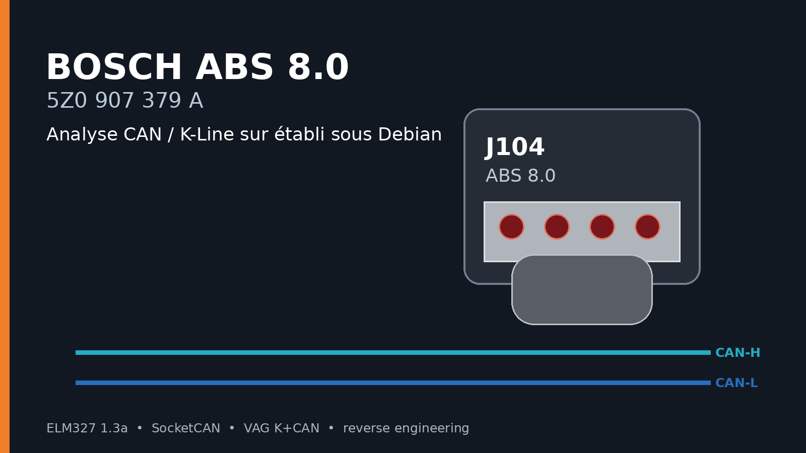
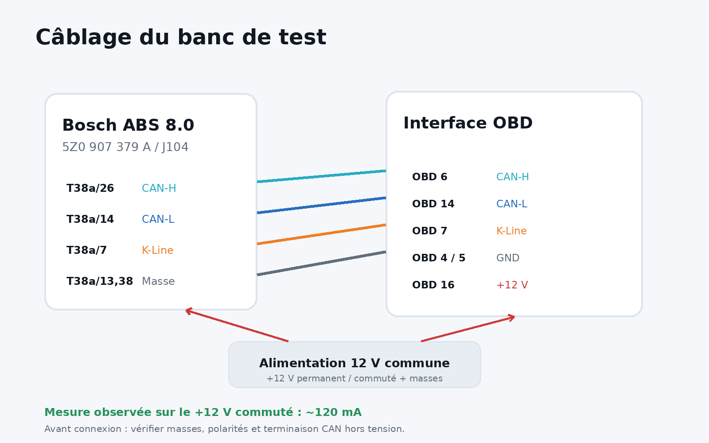
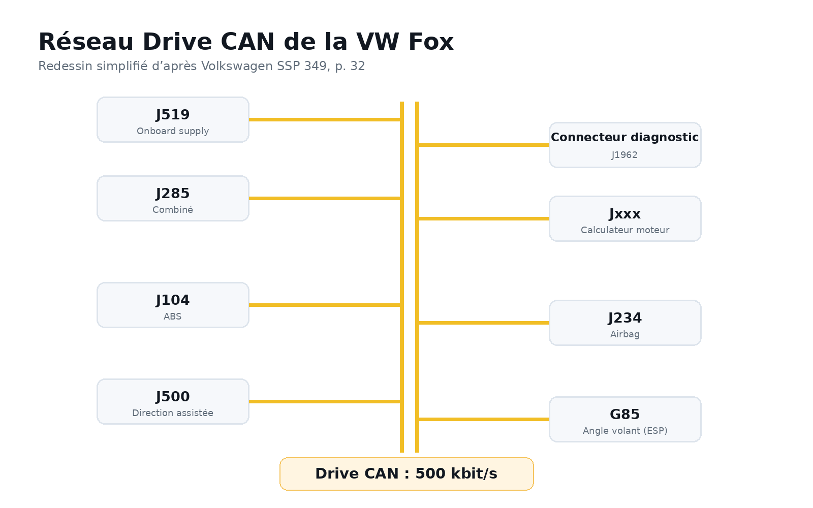
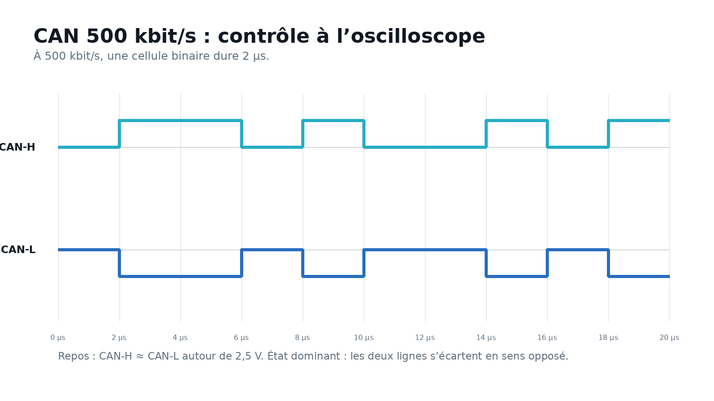
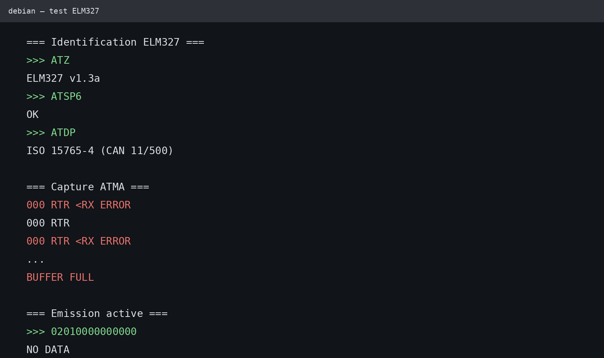
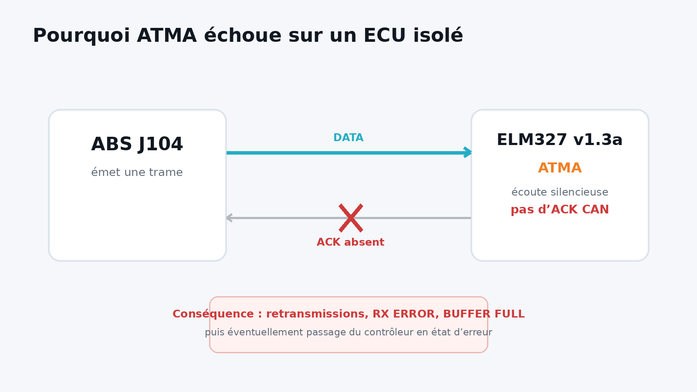
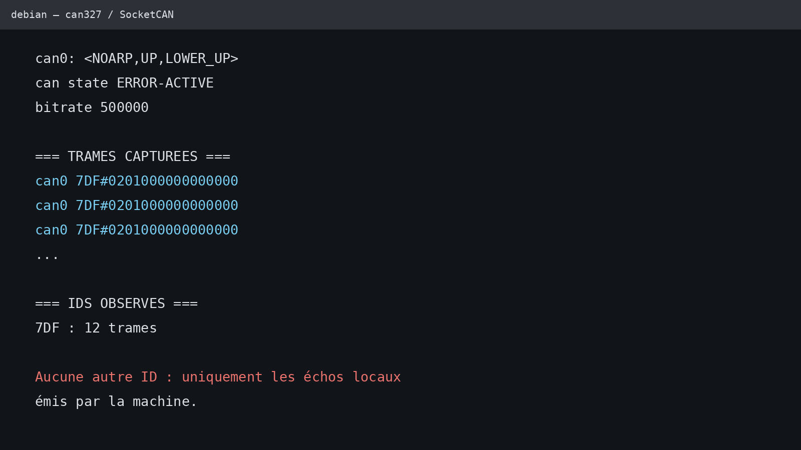
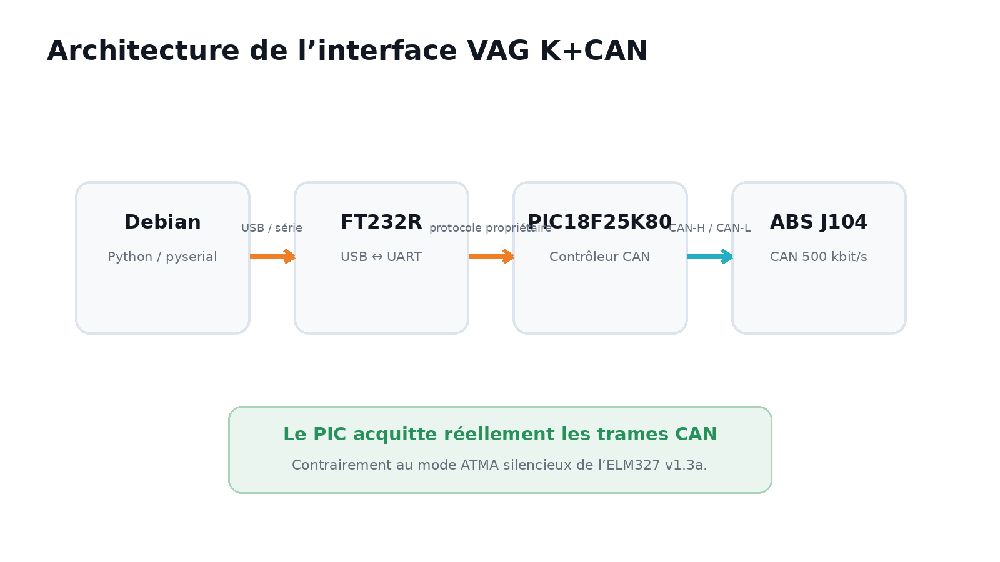
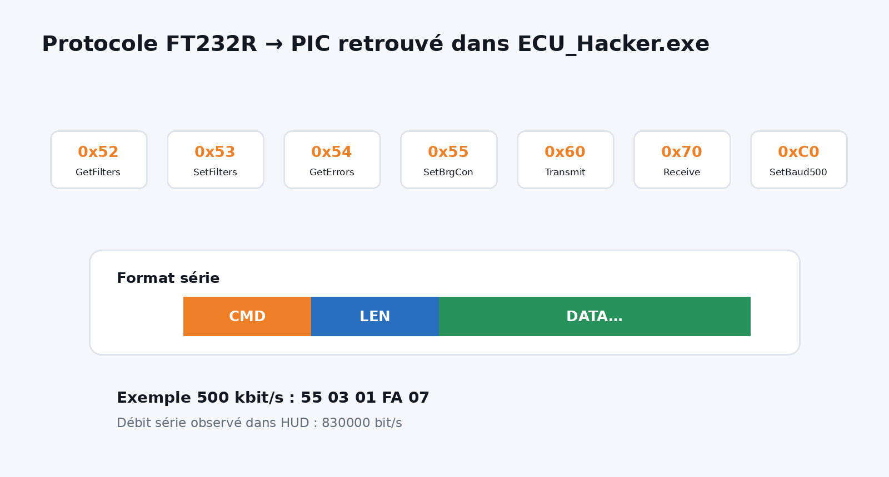

Je voulais vérifier sur établi le fonctionnement d'un calculateur ABS Bosch 8.0 portant la référence Volkswagen **5Z0 907 379 A**, sans véhicule complet et sans dépendre d'un logiciel de diagnostic Windows.

Le point de départ était limité : alimenter le J104, vérifier qu'il démarre, puis déterminer s'il communique encore sur K-Line et sur CAN. Les essais ont finalement mené à l'analyse du protocole série d'une interface VAG K+CAN afin de la piloter directement depuis Debian.

> **État de l'article.** Les mesures électriques et les sorties terminal reproduites ici proviennent de mon banc. Les commandes du protocole VAG K+CAN décrites en fin d'article proviennent de l'analyse de `ECU_Hacker.exe` extrait de HUD ECU Hacker 6.1. La capture matérielle finale avec `vagkcan_sniff.py` reste à valider sur le bloc.

## Le calculateur ABS

La référence **5Z0 907 379 A** est associée au module Bosch **0 265 800 468** et au bloc hydraulique **5Z0 614 117 B / Bosch 0 265 231 626** sur VW Fox.[^absref]

La documentation électrique de la Fox identifie le calculateur ABS comme **J104** avec un connecteur **T38a à 38 voies**.[^wiring]

Pour les essais qui nous intéressent :

| Broche J104 | Fonction utilisée sur le banc |
|---:|---|
| T38a/26 | CAN-H |
| T38a/14 | CAN-L |
| T38a/7 | K-Line |
| T38a/13, T38a/38 | masses, suivant schéma/version |



Sur le +12 V commuté, j'ai mesuré environ **120 mA**. Cette consommation ne prouve pas à elle seule que le calculateur est sain, mais elle confirme qu'une partie de l'électronique est alimentée.

## Le CAN de la Fox

Le programme autodidactique Volkswagen SSP 349 place le J104 sur le **Drive CAN à 500 kbit/s**.[^ssp349]



*Figure redessinée d'après Volkswagen SSP 349, page 32. Le document original est référencé dans les sources.*

Une photo de référence correspondant exactement à la famille de bloc `5Z0907379A / 0265800468` est disponible chez Techniczentrum.[^absphoto]


*Photo de référence : Techniczentrum. L’image est chargée depuis le site source et n’est pas redistribuée dans ce ZIP.*

## Première vérification à l'oscilloscope

Avant d'essayer un protocole de diagnostic, j'ai observé CAN-H et CAN-L directement à l'oscilloscope. Une activité était présente, avec les deux lignes qui évoluaient en opposition.



À 500 kbit/s, une cellule binaire dure **2 µs**. Cette mesure permet de vérifier le débit sans dépendre du décodage d'un adaptateur USB.

## Premier essai avec un ELM327

L'interface USB utilisée apparaît sous Debian comme un FT232R :

```text
idVendor=0403
idProduct=6001
Product: FT232R USB UART
Manufacturer: FTDI
SerialNumber: A900633V
```

Elle répond à 38400 bit/s comme un ELM327 :

```text
ATZ
ELM327 v1.3a

ATI
ELM327 v1.3a

AT@1
OBDII to RS232 Interpreter
```

Le CAN 11 bits à 500 kbit/s est sélectionné avec :

```text
ATSP6
```

puis confirmé par :

```text
ATDP
ISO 15765-4 (CAN 11/500)
```

## Pourquoi `ATMA` donne des erreurs sur le banc

La première écoute brute a donné :

```text
000 RTR <RX ERROR
000 RTR
000 RTR <RX ERROR
...
BUFFER FULL
```



Le comportement vient d'une limitation importante de l'ELM327. La documentation Elm Electronics indique que `AT MA` place l'interface en écoute silencieuse : en CAN, elle **n'acquitte pas les trames**, sauf si le silent mode est explicitement désactivé avec `CSM0` sur les versions qui disposent de cette commande.[^elm327]

Sur un véhicule complet, d'autres calculateurs acquittent le trafic. Sur un banc composé essentiellement du J104 et de l'ELM327, personne ne pose le bit ACK.



Le calculateur retransmet alors ses messages et ses compteurs d'erreur CAN peuvent monter. Cela explique beaucoup mieux les `RX ERROR` et le remplissage du buffer que l'hypothèse d'un CAN à mauvais débit.

## Émission active avec l'ELM327

Pour sortir du mode silencieux, j'ai fait émettre une trame par l'ELM :

```text
ATSP6
ATCAF0
ATSH7DF
02010000000000
```

Résultat :

```text
NO DATA

ATCS
T:00 R:00
```

`NO DATA` n'est pas un `CAN ERROR`. L'ELM a attendu une réponse applicative qui n'est jamais arrivée. C'est logique : `7DF / 01 00` est une requête OBD-II générique, pas une requête destinée au J104.

## Essai avec `can327` et SocketCAN

Linux fournit le pilote **can327**, qui transforme certains ELM327 série en interface SocketCAN. La documentation du noyau le présente comme un pilote "best effort" et précise qu'il est prévu pour les ELM327 **1.4b et plus récents**.[^can327]

Après :

```bash
sudo modprobe can327
```

puis `ldattach`, l'interface apparaissait correctement :

```text
can0: <NOARP,UP,LOWER_UP>
can state ERROR-ACTIVE
bitrate 500000
```

Mais la capture contenait seulement les trames envoyées localement :



Le `v1.3a` reste donc mauvais pour l'objectif recherché ici : écouter proprement un seul ECU tout en maintenant un bus CAN actif et acquitté.

## Tentative KWP2000 sur K-Line

Le calculateur dispose aussi d'une K-Line. J'ai essayé les protocoles ISO 14230 de l'ELM327 :

```text
ATTP4   # KWP2000, 5-baud init
ATTP5   # KWP2000, fast init
```

Les premières tentatives avec `ATSI` et `ATFI` renvoyaient `?`. Sur cet ELM327 v1.3a, ces commandes d'initialisation manuelle ne sont pas disponibles.

En déclenchant l'initialisation automatiquement avec la première requête :

```text
ATTP4
ATIIA03
ATSH8203F1
1089
```

j'obtiens :

```text
BUS INIT: FB ERROR
```

Même chose en fast init :

```text
ATTP5
ATSH8103F1
81
```

```text
BUS INIT: FB ERROR
```

Le `FB ERROR` intervient pendant l'initialisation physique de la ligne. Ce test n'a donc pas établi que le J104 refusait KWP2000. Pour continuer sur K-Line, un câble KKL simple est un meilleur outil que cet ELM.

## Passage au VAG K+CAN

J'avais également une interface VAG K+CAN Commander. Sous Debian elle apparaît elle aussi comme un FT232R :

```text
idVendor=0403
idProduct=6001
Product: FT232R USB UART
Manufacturer: FTDI
SerialNumber: A75OBPRN
```

Mais son architecture est différente. HUD ECU Hacker documente les clones VAG K+CAN comme des adaptateurs constitués d'un **FTDI** et d'un **PIC18F25K80** capable de communiquer sur le bus CAN.[^hud]



Ce PIC est ce qui rend l'interface intéressante : il possède un vrai contrôleur CAN et peut acquitter les trames reçues.

## Détour par Wine

HUD ECU Hacker supporte officiellement le VAG K+CAN. J'ai donc tenté de le lancer sous Wine.

Le mapping série fonctionnait réellement :

```text
COM9 -> /dev/serial/by-id/usb-FTDI_FT232R_USB_UART_A75OBPRN-if00-port0
      -> /dev/ttyUSB0
```

Un petit programme .NET confirmait :

```text
Ports vus par .NET :
  COM1
  COM2
  COM3
  COM4
  COM5
  COM6
  COM9

Test ouverture COM9 :
  OPEN COM9 : OK
  IsOpen    : True
```

Pourtant HUD n'affichait pas COM9. La liaison série fonctionnait donc dans Wine, mais pas la méthode d'énumération utilisée par HUD. Continuer à corriger Wine n'apportait plus grand-chose.

## Analyse de HUD ECU Hacker

J'ai analysé l'installateur HUD ECU Hacker 6.1 directement.

La charge utile de l'installateur est stockée dans une ressource Windows `RCDATA`. Après extraction du conteneur, j'ai récupéré :

```text
ECU_Hacker.exe
```

Il s'agit d'un assembly .NET. La décompilation permet de suivre la classe qui pilote le VAG K+CAN et les écritures vers `System.IO.Ports.SerialPort`.

Plusieurs commandes du protocole FT232R vers PIC apparaissent directement dans le code :

```text
0x51  SetBaud100
0x52  GetFilters
0x53  SetFilters
0x54  GetErrors
0x55  SetBrgCon
0x60  Transmit
0x70  Receive
0xC0  SetBaud500
```



Le format général est :

```text
[commande] [longueur] [données...]
```

Pour une configuration CAN à 500 kbit/s, le code construit notamment :

```text
55 03 01 FA 07
```

Le port FT232R est ouvert à **830000 bit/s** dans cette implémentation. Le reset du PIC est réalisé avec DTR/RTS.

Les événements CAN reçus remontent avec la commande `0x70`, suivie d'une longueur, d'un identifiant encodé et des données CAN.

## Un sniffer Linux natif

À partir de ces informations, j'ai écrit `vagkcan_sniff.py`, fourni avec cet article dans `scripts/`.

Le programme :

1. ouvre le FT232R directement depuis son chemin `/dev/serial/by-id/` ;
2. reproduit le reset du PIC ;
3. sauvegarde les filtres existants ;
4. configure le CAN à 500 kbit/s ;
5. ouvre les filtres 11 bits pour la capture ;
6. décode les messages `0x70` ;
7. restaure les filtres d'origine à la fermeture.

Installation :

```bash
sudo apt install python3-serial
```

Puis :

```bash
python3 scripts/vagkcan_sniff.py \
    --duration 30 \
    --capture /tmp/abs_can.log \
    --verbose
```

À ce stade, le protocole série a été reconstruit à partir du code de HUD ECU Hacker et le script possède ses autotests. La prochaine étape est la validation matérielle sur mon exemplaire de VAG K+CAN et sur le J104.

## Suite de l'analyse

Une fois les premières trames du J104 récupérées, je veux caractériser chaque ID :

```text
ID
DLC
nombre de trames
période moyenne
fréquence
octets constants
octets variables
```

Puis stimuler séparément :

- les quatre entrées de capteurs de roue ;
- le contact de frein ;
- éventuellement les états d'alimentation et les défauts injectés.

Le but est de retrouver les messages qui transportent les vitesses de roues et les états du calculateur, sans avoir besoin du reste du véhicule.

## Bilan provisoire

L'ELM327 a servi à vérifier que le CAN à 500 kbit/s était exploitable en émission, mais son mode `ATMA` silencieux est mal adapté à un ECU isolé. `can327` améliore l'intégration Linux, mais mon contrôleur `v1.3a` est plus ancien que la version recommandée par le pilote.

Le VAG K+CAN est plus adapté à ce banc grâce au PIC qui gère réellement le CAN. L'obstacle était son protocole série propriétaire. L'analyse de HUD ECU Hacker a fourni suffisamment d'informations pour commencer à remplacer le logiciel Windows par un outil Debian natif.

Le chemin final devient donc :

```text
ABS Bosch 8.0 / J104
        |
        | CAN 500 kbit/s
        v
VAG K+CAN
FT232R + PIC18F25K80
        |
        | protocole série analysé
        v
Debian + Python
        |
        v
capture et analyse CAN
```

La prochaine mise à jour de cet article dépendra d'une chose très concrète : la première capture stable des trames spontanées du J104 avec `vagkcan_sniff.py`.

## Sources

[^absref]: Techniczentrum, fiche du module ABS VW Fox `5Z0614117B / 0265231626 / 0265800468 / 5Z0907379A` : https://techniczentrum.com/fr/pompes-abs/6426-module-abs-volkswagen-fox-5z0614117b-0265231626-0265800468-5z0907379a.html
[^absphoto]: Photo de référence exacte du bloc : https://techniczentrum.com/36678-large_default/module-abs-volkswagen-fox-5z0614117b-0265231626-0265800468-5z0907379a.jpg
[^wiring]: Portal Diagnostov, VW Fox 2006 ABS, J104 et connecteur T38a : https://portal-diagnostov.com/en/2021/01/24/6642552-vw-fox-2006-anti-lock-brake-system-abs-f6g-wiring-diagrams-pin-connect/
[^ssp349]: Volkswagen SSP 349, *Fox 2006*, p. 32, Drive CAN à 500 kbit/s : https://www.volkspage.net/technik/ssp/ssp/SSP_349_d2.pdf
[^elm327]: Elm Electronics, documentation ELM327, commande `MA` et absence d'ACK CAN en mode silencieux : https://www.elmelectronics.com/wp-content/uploads/2016/07/ELM327DS.pdf
[^can327]: Documentation du noyau Linux, `can327: ELM327 driver for Linux SocketCAN` : https://docs.kernel.org/networking/device_drivers/can/can327.html
[^hud]: HUD ECU Hacker, section VAG K+CAN : https://www.netcult.ch/elmue/HUD%20ECU%20Hacker/
