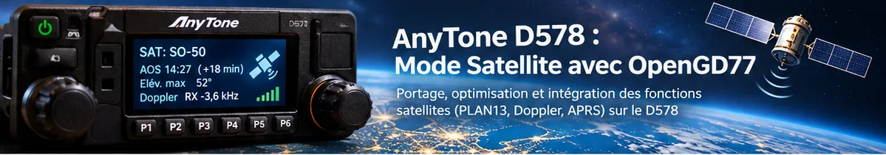
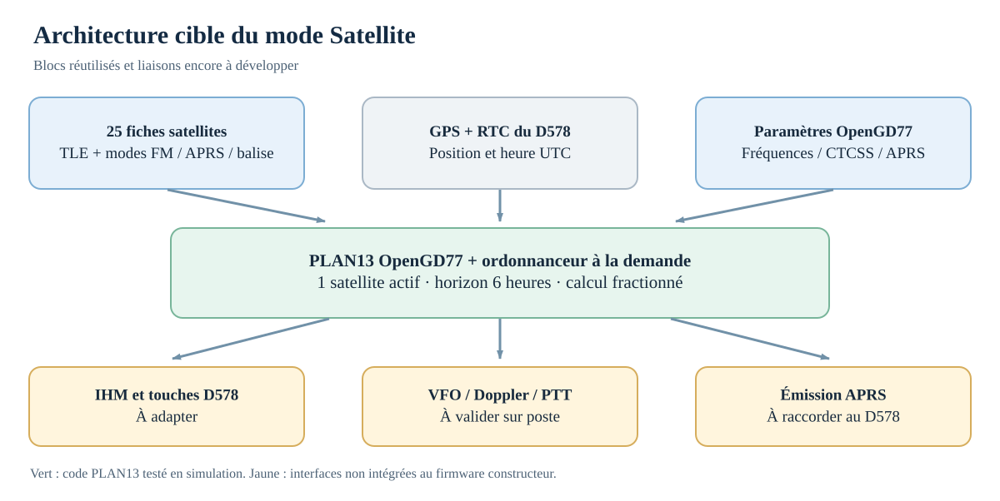
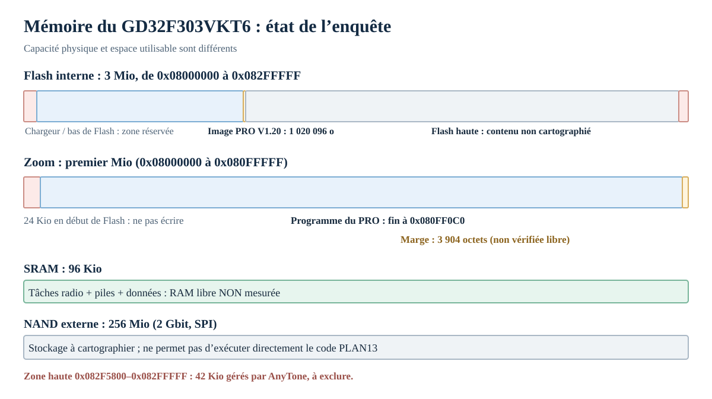
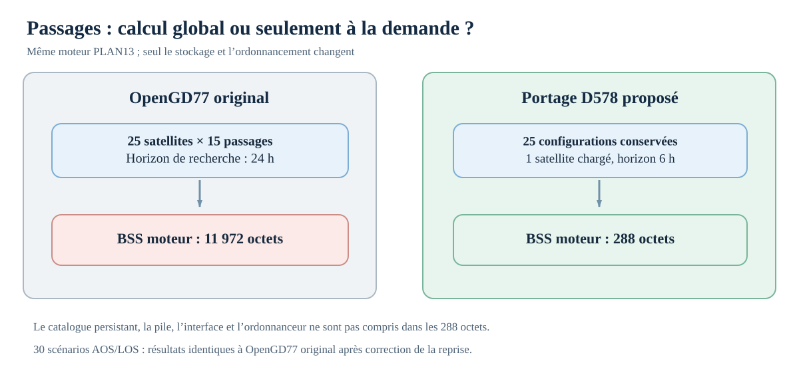

*Illustration conceptuelle. L’écran représenté n’est pas une photographie d’un firmware déjà installé sur le D578.*

L’AnyTone D578UV PRO est un mobile VHF/UHF capable de fonctionner en FM et en DMR, avec deux voies radio et un GPS. Il lui manque pourtant une fonction particulièrement pratique en trafic satellite : **la prédiction des passages associée à une correction Doppler indépendante des fréquences de réception et d’émission**. Elle existe déjà dans OpenGD77 sur d’autres postes, notamment le TYT MD-9600. Elle a aussi existé dans le firmware constructeur du portable AnyTone D878.

L’objectif de ce projet est d’intégrer ce mode Satellite au **D578UV PRO à microcontrôleur GD32**, sans perdre les fonctions radio courantes. Il ne s’agit pas de remplacer tout le firmware AnyTone par OpenGD77, mais d’en réutiliser le moteur orbital, l’interface et l’émission APRS, puis de raccorder ces éléments au matériel du D578.

**État au 1er novembre 2026 :** les analyses statiques et le moteur de prédiction adapté fonctionnent sur ordinateur. Aucun D578 n’a encore exécuté un firmware modifié. Aucun fichier `.CDD` prêt à flasher n’a été produit.

## Ce que le mode Satellite doit apporter

Lorsqu’un satellite radioamateur défile au-dessus de l’horizon, le poste doit afficher le prochain passage (AOS/LOS), l’azimut, l’élévation et les fréquences corrigées. Pendant le passage, la correction Doppler doit suivre séparément la voie RX et la voie TX. Le mode doit permettre de passer entre trois configurations prévues par OpenGD77 : **phonie FM**, **APRS** et **réception de balise**.

| Fonction | Objectif pour le D578 | Situation actuelle |
|---|---|---|
| Liste de satellites | Jusqu’à 25 configurations modifiables | Catalogue prévu dans le prototype |
| Prédiction AOS/LOS | Prochain passage à la demande, sur 6 h | Fonction PLAN13 adaptée et testée hors poste |
| Azimut et élévation | Affichage numérique et polaire OpenGD77 | Calcul existant ; écran D578 non raccordé |
| Doppler RX/TX | Corrections indépendantes durant le passage | Algorithme connu ; commande RF D578 non validée |
| FM et CTCSS | Exploiter les répéteurs FM interbandes | Pilote radio à adapter |
| APRS satellite TX | Émettre une balise sur la configuration satellite | Fonction OpenGD77 disponible ; interface D578 non raccordée |
| APRS analogique RX | Recevoir les paquets AX.25 terrestres ou satellites | Dépend notamment de la carte APRS+Bluetooth du D578 PLUS |

Le **catalogue de 25 satellites n’est pas une liste de 25 satellites opérationnels**. C’est une capacité de configuration. Les satellites et leurs modes actifs doivent être vérifiés lors de la mise à jour des TLE et des paramètres de fréquence.

## Les sources réellement utilisées

Le travail est parti des archives constructeurs, des sources OpenGD77 et des documents techniques sur les modifications du D578.

| Source | Version ou élément | Ce qu’elle nous a appris |
|---|---|---|
| AnyTone D578UV PRO | Firmware GD V1.20, 31/01/2024 | Organisation du programme, menus, fréquences, Flash |
| AnyTone D578UV PLUS | Firmware GD V2.08, 19/06/2024 | Fonctions communes au PRO et différences APRS |
| AnyTone D878UVII PLUS | Firmware V3.07, 29/04/2025 | Gestion du Doppler, structures satellite et adaptation des fréquences |
| OpenGD77 pour TYT MD-9600 | Sources **R20260131** | Moteur **PLAN13**, interface satellite, APRS TX |
| OpenGD77 MD-9600 | Binaires pour révisions matérielles V4 et V5 | Contrôle comparatif des modules recompilés |
| Travaux de VK7ZJA | Documentation technique D578 | Architecture du poste et pistes d’accès aux mémoires |
| Composants identifiés sur le matériel | GD32F303VKT6 et TC58CVG1S3HRAIG | Capacités et séparation entre Flash interne, SRAM et NAND externe |

Les sources V4 et V5 du MD-9600 compilent en objets identiques pour les trois modules étudiés (`satellite.c`, `menuSatelliteScreen.c`, `aprs.c`). Cela ne signifie pas que leurs firmwares complets sont identiques : les deux images fournies ont chacune **767 536 octets**, mais diffèrent à **273 512 positions**.

Le portage utilise volontairement la référence OpenGD77 **R20260131**, celle dont les sources ont été fournies et mesurées. Ce n’est pas une affirmation qu’il s’agit de la dernière version publiée.

## Ce que nous avons appris sur l’électronique du D578

Sur les deux exemplaires étudiés, l’identification matériel/firmware confirme la famille **GD32**, dont l’un possède un **GD32F303VKT6** observé sous l’écran. La documentation de GigaDevice donne les caractéristiques suivantes :

| Composant / mémoire | Caractéristique vérifiée | Rôle dans notre projet |
|---|---|---|
| GD32F303VKT6 | ARM Cortex-M4, jusqu’à 120 MHz | Exécution du firmware et des calculs orbitaux |
| Flash interne GD32 | **3 Mio** (3 072 Kio) | Programme AnyTone et éventuelle extension exécutable |
| SRAM interne | **96 Kio** | Pile, variables radio, données satellites actives |
| Toshiba/Kioxia TC58CVG1S3HRAIG | NAND SPI **2 Gbit**, soit **256 Mio** | Stockage persistant envisageable pour TLE et configurations |
| Carte APRS+Bluetooth | Firmware séparé sur le PLUS | Réception analogique APRS ; sujet distinct du portage Satellite |

**La NAND de 256 Mio ne peut pas être considérée comme 256 Mio de mémoire programme.** Ses pages contiennent 2 048 octets utiles et 64 octets supplémentaires ; l’effacement se fait par blocs de 128 Kio utiles, avec correction d’erreurs ECC. Ses pages contiennent 2 048 octets utiles et 64 octets supplémentaires ; l’effacement se fait par blocs de 128 Kio utiles, avec correction d’erreurs ECC. C’est un stockage externe par pages et blocs, avec ECC et gestion des blocs défectueux. Nous pourrions y conserver les TLE et les fiches des satellites **après identification d’une zone sûre**, mais le code du moteur orbital doit disposer d’un emplacement exécutable approprié dans la mémoire du microcontrôleur.

*Architecture cible : les blocs OpenGD77 sont déjà exploitables en simulation ; leurs adaptateurs IHM, stockage, radio et APRS ne sont pas encore intégrés au firmware AnyTone.*

### La Flash interne : de la capacité physique, mais une carte mémoire incomplète

La comparaison des images GD a permis de retrouver leur base d’exécution `0x08006000`, leur longueur dans les métadonnées `.CDI`, et leur adresse de fin.

| Image GD | Longueur `.CDD` | Adresse de fin exclusive | Espace avant `0x08100000` |
|---|---:|---|---:|
| D578UV PRO V1.20 | 1 020 096 octets | `0x080FF0C0` | **3 904 octets** |
| D578UV PLUS V2.08 | 1 020 408 octets | `0x080FF1F8` | **3 592 octets** |

Le PRO occupe donc presque toute la première tranche de 1 Mio. Le fait que le GD32 possède 3 Mio de Flash ne signifie pas que les 2 Mio supérieurs sont disponibles pour nos programmes.

Le désassemblage montre des accès à **`0x082F5800`** et **`0x082FF800`**. Une routine autour de `0x0808CDB2` manipule **21 blocs de 2 Kio**, avec des opérations d’effacement et de transfert. Nous considérons donc la zone **`0x082F5800` à `0x082FFFFF`**, soit **42 Kio**, comme **réservée au fonctionnement constructeur**. La nature exacte des données qui s’y trouvent reste inconnue.

Les secteurs compris entre `0x08100000` et `0x082F5800` ont un statut **inconnu**, et non « libre ». La méthode d’écriture du chargeur, les protections SWD et les besoins de récupération devront être vérifiés sur un poste réel avant tout essai.

### La RAM : ne pas confondre capacité et disponibilité

La SRAM totale est de **96 Kio**. L’image du PRO contient une valeur de pile initiale de `0x200170E0`, proche du haut de cette plage. Cela ne nous donne **pas** la quantité de RAM disponible en fonctionnement. Les tâches DMR, l’audio, les buffers, l’affichage, les interruptions et les piles consomment déjà de la mémoire.

Nous avons donc mesuré la RAM **ajoutée par les objets du moteur orbital**, sans inventer une estimation globale de la mémoire libre du poste. La réduction de la BSS est un résultat de compilation ; la consommation totale avec piles et appels des fonctions radio reste à mesurer sur matériel.

## Ce que le désassemblage a permis d’identifier

Les images AnyTone contiennent du code ARM Thumb-2 analysable. La comparaison PRO V1.20 / PLUS V2.08 couvre aussi deux **dates de firmware différentes** : certaines différences peuvent donc venir de la version, et non du modèle. La comparaison PRO V1.20 / PLUS V2.08 couvre aussi deux **dates de firmware différentes** : certaines différences peuvent donc venir de la version, et non du modèle. Les résultats ci-dessous proviennent de comparaisons binaires et d’instructions désassemblées ; il ne s’agit pas d’une décompilation C complète avec symboles constructeur.

| Recherche | Indice vérifié | Ce que nous pouvons en déduire |
|---|---|---|
| Gestion des fréquences GD du D578 | Routine commune PRO/PLUS à `0x0804EAC6` | Point de raccordement candidat, **pas** commande RF sûre à employer telle quelle |
| Menu `Work Alone` | Trois tables de **29 entrées** ; sélecteur à `0x0803B966` | Un libellé partagé ne suffit pas à créer une action Satellite |
| Doppler sur D878 V3.07 | Bloc vers `0x080791B0` avec deux corrections de signes opposés | Le firmware D878 actualise séparément deux fréquences |
| Transfert des fréquences D878 | Routine autour de `0x08079C32` | Les résultats rejoignent le gestionnaire de configuration radio |
| Traitement des fréquences | Format BCD sur quatre octets, unités de **10 Hz** | Conversion à respecter dans un futur adaptateur D578 |
| APRS du PRO | Parseur de trames commun avec le PLUS, dont une séquence GD de **210 octets identiques** | Le programme principal connaît des trames APRS déjà décodées |

Un autre élément a évité une fausse piste : la chaîne `Satellite/PACsat` trouvée dans le D578 fait partie **des symboles APRS**, pas d’un menu Satellite dormant.

Une seconde précaution concerne le code OpenGD77 : un calcul de différence de fréquence utilise `abs()` sur une soustraction d’entiers non signés. Ce chemin devra être corrigé et testé pour le Doppler du D578.

Une seconde précaution concerne le code OpenGD77 : un calcul de différence de fréquence utilise `abs()` sur une soustraction d’entiers non signés. Ce chemin devra être corrigé et testé pour le Doppler du D578.

Enfin, AnyTone a corrigé des erreurs de fréquence TX et de précision de passage dans le D878 **V3.08N**, puis retiré sa fonction satellite en **V4.00** après des problèmes de stabilité annoncés par le fabricant. Nous ne prévoyons donc pas de recopier son code machine. La version D878 sert de référence pour comprendre l’intégration dans les structures AnyTone.

## Réduire le firmware AnyTone : fonctions sacrifiables, gains encore inconnus

Le propriétaire n’utilise pas plusieurs fonctions actuellement installées sur ses D578 : enregistrement vocal, 2Tone/5Tone, Work Alone, Weather Alarm, réception FM commerciale, Roaming DMR, CH Ranging et fonctions de chiffrement/scrambler.

| Fonctions candidates | Ce que l’on pourrait conserver ou réaffecter | Résultat aujourd’hui |
|---|---|---|
| Work Alone | Entrée de menu et navigation | Références retrouvées, gestionnaire non isolé |
| Enregistrement vocal | Menu, traitement propre à l’enregistrement | Dépendances audio à cartographier |
| 2Tone / 5Tone | Signalisation spécialisée | Routines exclusives pas encore délimitées |
| Weather, FM commerciale, CH Ranging | Écrans et traitements dédiés | Gains Flash non mesurés |
| Roaming DMR, Scrambler, Encryption | Fonctions facultatives pour ce projet | Ne pas endommager les traitements DMR partagés |

Supprimer un mot du menu ne libère pas le code qui réalise la fonction. Même retirer une routine suppose de savoir quels autres traitements l’appellent. **À ce stade, aucun octet de code constructeur n’est comptabilisé comme récupéré.** Nous conservons la FM radioamateur, le DMR, les deux voies, le GPS, le Bluetooth, le CTCSS/DCS, l’APRS et les protections TX.

## Pourquoi nous avons abandonné notre moteur SGP4

Le premier prototype utilisait **SGP4**, avec ses propres calculs de géométrie, sa recherche des passages et une interface simplifiée. Les tests fonctionnaient, mais le code prenait de la place et ajoutait des dépendances logicielles pour le calcul en double précision sur Cortex-M4.

Après récupération des sources complètes OpenGD77 du MD-9600, nous avons compilé les modules existants **avec les mêmes options ARM Cortex-M4, `-Os`**, puis comparé les tailles réelles des objets :

| Bloc logiciel | Flash ARM non liée |
|---|---:|
| OpenGD77 : PLAN13 + prédictions + Doppler | **5 298 octets** |
| Notre premier SGP4 + géométrie + prédiction | **16 304 octets** |
| OpenGD77 : interface Satellite complète | **8 442 octets** |
| Notre interface simplifiée | **1 288 octets** |
| **OpenGD77 orbital + interface** | **13 740 octets** |
| **Notre prototype orbital + interface** | **19 032 octets** |
| OpenGD77 : sous-système APRS TX complet | **8 821 octets** |
| OpenGD77 : orbital + interface + APRS complet | **22 561 octets** |

OpenGD77 économise donc **5 292 octets** sur l’ensemble orbital + interface, tout en fournissant les écrans de passage, les tracés polaires et le comportement APRS déjà utilisés sur d’autres postes. Le bloc APRS complet n’a pas forcément besoin d’être embarqué tel quel, puisque le D578 possède déjà des fonctions d’émission APRS.

Ces tailles sont celles **des objets avant édition de liens**, sans les bibliothèques mathématiques, ni les pilotes, ni le code partagé éliminé par le linker. Ce ne sont pas encore les tailles d’un firmware D578 intégré.

## Calculer le prochain passage uniquement à la demande

OpenGD77 prévoit normalement jusqu’à **25 satellites** et **15 emplacements de passage** chacun, sur un horizon initial de **24 heures**. Ce fonctionnement est utile pour un panorama de tous les passages, mais disproportionné pour une session de quelques heures sur un seul satellite.

Nous avons commencé par limiter la recherche à **6 heures**. Cela diminue les calculs de prédiction, **pas** la taille du moteur ou sa RAM à lui seul. Il fallait également repenser ce qui restait en mémoire.

| Organisation du moteur PLAN13 | BSS de `satellite.c` | Économie par rapport à l’original |
|---|---:|---:|
| 25 satellites × 15 emplacements | 11 972 octets | Référence |
| 25 satellites × 6 emplacements | 7 472 octets | 4 500 octets |
| 25 satellites × 2 emplacements | 5 472 octets | 6 500 octets |
| **1 satellite actif × 2 emplacements** | **288 octets** | **11 684 octets** |

Dans la configuration initiale, le tableau de 25 structures natives représentait **25 × 476 = 11 900 octets**, plus 72 octets d’état. Dans la dernière configuration, les **25 fiches configurables restent disponibles en stockage persistant**, tandis que seule la structure orbitale complète du satellite choisi est chargée. Le catalogue de 25 enregistrements de 100 octets, le contexte de l’ordonnanceur, l’interface et les piles sont à comptabiliser séparément. Les **288 octets** ne sont donc surtout pas une mesure de RAM totale du mode Satellite.

La liste générale des passages, si on souhaite la conserver, pourrait être **calculée seulement lorsque l’utilisateur l’ouvre**. Pendant un passage, on actualise la position et le Doppler du satellite suivi sans refaire la recherche du prochain AOS/LOS en permanence.

## Correction de la reprise AOS/LOS dans PLAN13

Un simple quota de calcul par appel ne suffisait pas. Dans les sources originales, atteindre `maxIterations` aboutissait à une **erreur de limite** au lieu d’une pause reprenable. Une seconde anomalie concernait la transition `INIT_LOS` : l’appel suivant pouvait réinitialiser la recherche de fin de passage.

La **Phase 9** a apporté des corrections minimales au code PLAN13 original, sans modifier sa formule de propagation. Le moteur peut maintenant poursuivre sa recherche sur plusieurs tours de boucle, avec un budget de propagations limité à chaque appel.

| Vérification réalisée hors poste | Résultat |
|---|---|
| Comparaison AOS/LOS avec OpenGD77 original | **30 scénarios sur 30 identiques à la seconde** |
| Quotas de propagations par appel | **1, 2, 4, 8, 16 et 32** testés |
| Chargement d’un seul satellite parmi 25 | Validé en simulation |
| Absence de passage dans les 6 h | Arrêt correct de la recherche |
| Activité radio simulée / PTT | Calcul suspendu dans l’adaptateur |
| UndefinedBehaviorSanitizer | Pas d’erreur détectée dans les tests exécutés |
| Compilation ARM Cortex-M4 `-Os` | Réussie, objets non liés |

Les **30 scénarios** utilisent deux jeux TLE historiques, cinq positions et trois instants chacun. Ils montrent que les corrections conservent les **résultats du code original**, pas que les prédictions sont précises sur des TLE actuels ou sur le matériel AnyTone.

Le noyau Phase 9 représente seulement :

| Partie OpenGD77 adaptée | Code et constantes ARM non liés |
|---|---:|
| PLAN13 légèrement corrigé | 5 310 octets |
| Ordonnanceur de passage à la demande | 348 octets |
| Adaptateur de sélection / données satellite | 722 octets |
| **Total** | **6 380 octets** |

La BSS du noyau mesurée est de **288 octets**, hors contexte d’adaptation, catalogue persistant, interface, pile et autres traitements. Le moteur satellite fonctionne désormais **en simulation**. Les liaisons vers le D578 restent à développer.

## APRS satellite : ce qui est prévu et ce qui ne l’est pas

OpenGD77 propose déjà l’émission APRS depuis le mode Satellite lorsque la configuration APRS est choisie. Le programme construit la trame AX.25 et adapte les paramètres de fréquence satellite. Il faudra retrouver le chemin qui transforme cette trame en émission AFSK sur le D578 et le raccorder avec les sécurités PTT.

**La réception APRS analogique est une question différente.** Le PRO possède déjà du code de traitement de paquets décodés, mais la réception analogique du PLUS dépend d’une carte APRS+Bluetooth distincte. Le projet de mode Satellite ne supprimera pas ce besoin matériel. Il doit pouvoir fonctionner en phonie et en APRS **TX** sur le PRO sans prétendre activer miraculeusement l’APRS **RX**.

## Les limites qui resteront même après un portage réussi

Ce projet vise d’abord les **satellites à répéteur FM** et ceux qui transportent des paquets APRS compatibles avec le poste. Il ne transformera pas le D578 en récepteur satellite universel.

| Demande | Limite technique |
|---|---|
| Transpondeurs linéaires SSB / CW | Le D578 ne dispose pas du mode de réception SSB nécessaire à leur exploitation normale. |
| APRS analogique **RX** sur le PRO sans carte supplémentaire | Le nouveau menu Satellite n’ajoute pas physiquement la carte de décodage du PLUS. |
| Réception d’un satellite éteint ou mode désactivé | Le suivi orbital ne remplace pas la disponibilité réelle du transpondeur. |
| TLE et fréquences toujours à jour sans intervention | Aucune synchronisation Internet autonome n’est prévue dans le firmware à ce stade ; les données devront être chargées et vérifiées. |
| Flashage du binaire D878 ou MD-9600 dans le D578 | Ces images utilisent d’autres structures et pilotes matériels ; seule une adaptation ciblée est envisagée. |

## Ce qui fonctionne, et ce qui reste à démontrer

| Fonction / résultat | État au 01/11/2026 |
|---|---|
| Identification GD32F303VKT6 et NAND TC58CVG1S3HRAIG | **Vérifiée** |
| Extraction des images GD et métadonnées `.CDD/.CDI/.spi` | **Vérifiée** |
| Comparaison statique D578 PRO/PLUS et D878 | **Vérifiée sur les fichiers fournis** |
| PLAN13 sélectionné, prédiction fractionnée et conservation du prochain passage | **Testée hors poste** |
| Empreinte des objets ARM OpenGD77 | **Mesurée, avant liaison** |
| Interface Satellite d’OpenGD77 sur l’écran D578 | **En cours** |

Rendu logique 128 × 64 pixels, agrandi pour la lecture. Les polices et couleurs sont simulées ; ce n'est pas une capture du LCD AnyTone.
Le calcul utilise un TLE historique et des fréquences de démonstration. Les trois écrans ont été testés avec le moteur PLAN13 issu de la Phase 9.

Le désassemblage du D578UV PRO GD V1.20 a permis d'identifier une séquence d'initialisation de l'afficheur et plusieurs routines de commande.
Adresse du firmware PRO	Fonction identifiée
0x080385F6	Émission d'un paramètre de configuration LCD
0x0803861A	Commande 0x36, orientation de l'affichage
0x080386F2	Commande 0x3A, format des pixels
0x080386F8	Paramètre 0x55, compatible avec le format RGB565
0x08038700	Commande 0x2C, écriture en mémoire graphique
0x08038704	Commande 0x2A, définition de la fenêtre horizontale
0x08038722	Commande 0x2B, définition de la fenêtre verticale
0x0808B5B2	Routine d'envoi d'une commande LCD
0x0808B636	Routine d'envoi de données LCD

Les appels ARM vers les deux dernières routines sont effectivement présents dans le binaire, avec des commandes cohérentes avec le protocole des contrôleurs TFT de cette famille.

Nous avons donc trouvé un point d'entrée nettement plus concret pour l'affichage réel. Il reste à vérifier la convention d'appel, les paramètres des fonctions graphiques de plus haut niveau et les éventuelles différences de la branche PLUS.
Une deuxième découverte : les fonctions de dessin sont communes au PRO et au PLUS
Les deux firmwares GD32 utilisent la même routine de définition d'une fenêtre graphique à 0x08021222. Son désassemblage montre la succession :
0x2A → coordonnées de la fenêtre
0x2B → coordonnées de la fenêtre
0x2C → envoi des pixels

Les routines d'envoi sont situées à des adresses légèrement différentes :
Fonction	PRO GD V1.20	PLUS GD V2.08
Écrire un octet sur le bus LCD	0x0808B594	0x0808B6A8
Envoyer une commande LCD	0x0808B5B2	0x0808B6C6
Envoyer une donnée LCD	0x0808B636	0x0808B74A
Définir la fenêtre graphique	0x08021222	0x08021222
Routine de rendu rectangulaire	0x0802126E	0x0802126E

Le code de la routine rectangulaire montre un argument supplémentaire passé sur la pile, compatible avec le passage d'une valeur de pixel ou d'un paramètre graphique. Sa signification exacte doit encore être confirmée.

C'est une bonne nouvelle : nous pouvons construire un adaptateur réutilisant les mécanismes LCD déjà présents, au lieu d'écrire un pilote complet pour le contrôleur. Pour l'instant, ces adresses sont des points d'entrée candidats identifiés statiquement, pas des fonctions dont l'appel depuis notre extension est validé sur matériel.

| Correction Doppler appliquée au RX/TX du D578 | **Non réalisée** |
| Émission APRS satellite depuis le D578 | **Non réalisée** |
| Emplacement Flash supplémentaire sûr | **Non identifié** |
| Temps CPU, pile maximale et RAM libre sur poste | **Non mesurés** |
| Firmware complet modifié, démarrage et récupération | **Non validés** |

La présence de 3 Mio de Flash et la réussite des tests ARM ne suffisent pas à conclure qu’une image modifiée sera chargeable par le bootloader. Un mauvais choix de zone ou de routine RF peut rendre le poste inutilisable.

## Prochaines étapes du portage

L’ordre retenu est le suivant :

1. **Adapter l’interface OpenGD77**, sans la redessiner : affichage, touches, GPS et horloge du D578.
2. **Choisir le stockage des TLE** et des 25 fiches, en identifiant d’abord les zones NAND réellement disponibles.
3. **Raccorder la consultation des fréquences**, en lecture seule, puis valider les conversions et l’état des VFO.
4. **Activer la correction Doppler RX**, avec lecture de retour ; ensuite seulement envisager la voie TX, en interdisant les changements pendant le PTT.
5. **Intégrer l’émission APRS satellite**, en conservant les contrôles de fréquence, de mode et de transmission.
6. **Cartographier la Flash avec une sonde SWD** et préparer une méthode de sauvegarde/récupération avant tout firmware expérimental.

Le premier essai matériel envisagé affichera des données calculées **sans toucher à la RF**. La vérification des fréquences suivra sur réception seule, avant les tests d’émission. Une sonde SWD compatible ARM est utile pour l’identification et la récupération, mais elle ne contourne pas une éventuelle protection mémoire et ne garantit pas qu’un poste pourra être restauré sans effacement.

### Ce que ce travail démontre aujourd’hui

Les sources OpenGD77 fournissent déjà l’essentiel du mode Satellite : calcul orbital PLAN13, interface de passages, correction Doppler et émission APRS. La réorganisation du calcul autour du seul satellite sélectionné réduit la BSS du moteur de **11 972 à 288 octets** dans notre configuration compilée, sans changer la formule de propagation.

Le travail restant porte surtout sur l’**adaptation du logiciel aux périphériques AnyTone** et sur l’intégration en Flash du GD32. Tant que les deux ne sont pas démontrés, ce projet reste un portage expérimental et non un firmware installable.

## Documentation et crédits

- [GigaDevice : GD32F303VKT6, caractéristiques du microcontrôleur](https://www.gigadevice.com/product/mcu/mcus-product-selector/gd32f303vkt6)
- [Kioxia TC58CVG1S3HRAIG, fiche composant](https://www.lcsc.com/product-detail/C20590728.html)
- [OpenGD77 : archives de sources et versions publiées](https://www.opengd77.com/downloads/releases/)
- [OpenGD77 : guide du mode Satellite et de l’APRS](https://github.com/Ub3apt/OpenGD77/blob/master/OpenGD77_User_Guide.md)
- [Archive des sources MD-9600 conservée par Telectroboy](https://github.com/Telectroboy/opengd77)
- [VK7ZJA : modifications et informations techniques sur le D578](https://hamradiosouthernrepeaters.co.uk/images/578Mods/578techmods.html)
- [AnyTone D878 : versions et retrait du mode Satellite](https://support.bridgecomsystems.com/anytone-878-v2-model-cps-firmware-downloads)

Les mesures et adresses citées proviennent des archives de travail et des rapports des phases 1 à 9 du projet, établis sur les firmwares fournis. Les sources OpenGD77 conservent leur licence spécifique, qui impose notamment la conservation des notices de droit d’auteur et **interdit l’usage commercial**. Les pilotes STM32 du projet MD-9600 ne doivent pas être recopiés tels quels pour un GD32.
