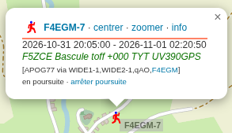

Une balise APRS OpenGD77 peut annoncer la fréquence sur laquelle l'opérateur est joignable en phonie. Lorsque l'option **Transmit QSY** est activée, le texte ajouté à la trame reprend normalement une fréquence, par exemple :

```text
145.500MHz Toff +000
```

J'ai modifié le firmware pour qu'une mémoire nommée puisse transmettre **le nom du canal à la place de la fréquence RX**. C'est pratique pour identifier directement un relais ou un canal sur une carte APRS, sans chercher à quelle fréquence correspond un nom dans son codeplug.

Cette modification, appelée **APRS Channel Name RC1**, a été **testée sur un TYT MD-UV390 GPS en émission RF**. Le message a été reçu et affiché sur **APRS.fi**.

## Validation en émission : capture APRS.fi



*Capture APRS.fi fournie après l'essai en émission sur TYT MD-UV390 GPS.*

La station **F4EGM-7** apparaît sur APRS.fi avec le texte suivant :

```text
F5ZCE Bascule toff +000 TYT UV390GPS
```

Le nom du canal est bien présent dans la balise reçue. La capture contient également le chemin APRS affiché par le site (`APOG77 via WIDE1-1,WIDE2-1,qAO,F4EGM`). **La validation ne se limite donc pas à un test logiciel : le poste a réellement transmis la balise.**

Cette observation confirme l'émission et l'affichage du nom de canal dans ce cas précis. Elle ne démontre pas qu'un logiciel APRS peut interpréter ce nom comme une fréquence QSY automatique.

## Comportement du correctif

Le correctif ne remplace la fréquence que lorsqu'un nom est disponible pour la mémoire sélectionnée.

| Situation | Texte QSY prévu |
|---|---|
| Mémoire nommée `RELAIS VHF` | `RELAIS VHF Toff +000` |
| Mémoire sans nom | `145.500MHz Toff +000` |
| Mode VFO | `145.500MHz Toff +000` |

Ces exemples servent à expliquer le fonctionnement. **Le cas effectivement observé sur APRS.fi** est celui de `F5ZCE Bascule`, reproduit dans la section précédente.

Le nom est récupéré avant que le poste bascule temporairement vers la fréquence APRS. La balise annonce donc le canal de trafic utilisé par l'opérateur, pas le nom d'une éventuelle mémoire consacrée à l'émission APRS.

Le traitement existant de la tonalité CTCSS, du décalage et du commentaire APRS est conservé. Aucun nouveau menu ni changement du format du codeplug n'est nécessaire.

## Configuration

Dans la configuration APRS du CPS OpenGD77, renseigner les paramètres habituels de la station, puis :

1. Configurer la fréquence d'émission APRS distincte de la fréquence de trafic.
2. Activer **Transmit QSY**.
3. Choisir une mémoire dont le nom identifie le canal ou le relais.
4. Émettre une balise et contrôler le texte reçu par un récepteur APRS ou sur APRS.fi.

Le nom doit provenir de la mémoire active. En mode VFO ou sur une mémoire sans nom, le correctif prévoit de conserver le format fréquence d'origine.

## Implémentation

La modification est basée sur le firmware `R20260131-DWAPRSG` pour **TYT MD-UV390 GPS** et porte sur le traitement APRS :

- `aprs.c` : adaptation de la construction du message dans `enqueuePayload()` ;
- `aprs_channel_name.h` : gestion du nom de canal utilisé dans le champ de texte QSY.

Le nom est extrait du champ de la mémoire de canal (16 octets dans le format utilisé). Le correctif prévoit un retour au comportement d'origine lorsque ce nom n'est pas disponible.

Cette version n'ajoute ni **réception APRS** ni **digipeater APRS**. Ces fonctions ne font pas partie de la modification présentée ici.

## Limite : le QSY automatique

Dans le format habituel, une application APRS peut rechercher une fréquence numérique telle que `145.500MHz` pour proposer un QSY. Le texte `F5ZCE Bascule` permet d'identifier le canal à la lecture, mais n'est pas une fréquence numérique normalisée.

**L'affichage sur APRS.fi est validé ; le QSY automatique à partir du nom de canal ne l'est pas.** Les applications qui attendent une fréquence peuvent ignorer cette information.

## État de validation

- **Compilé :** firmware de la modification APRS Channel Name RC1.
- **Testé sur matériel :** TYT MD-UV390 GPS.
- **Émission APRS RF :** validée.
- **Réception et affichage APRS.fi :** validés, capture ci-dessus.
- **QSY automatique par les clients APRS :** non validé et non garanti avec ce format textuel.

## Documentation

Le [guide utilisateur OpenGD77](https://github.com/LibreDMR/OpenGD77_UserGuide/blob/master/OpenGD77_User_Guide.md) présente les options APRS et le comportement QSY d'origine.

[Release GitHub !!!](https://github.com/Telectroboy/OpenGD77_Mods/releases/tag/APRSChanName_V1)
