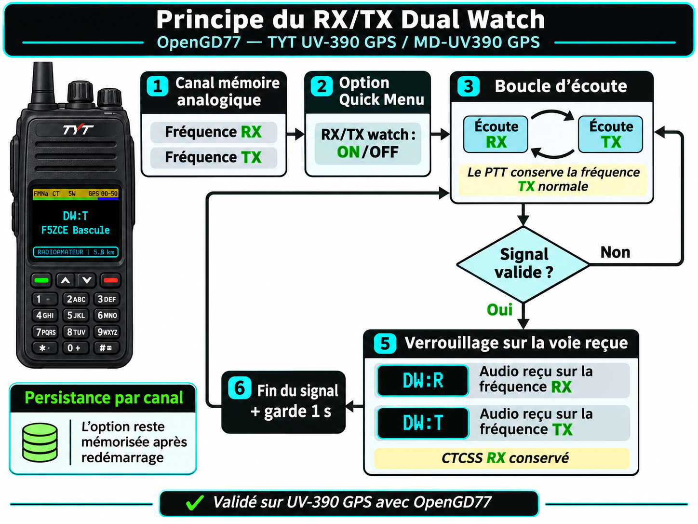
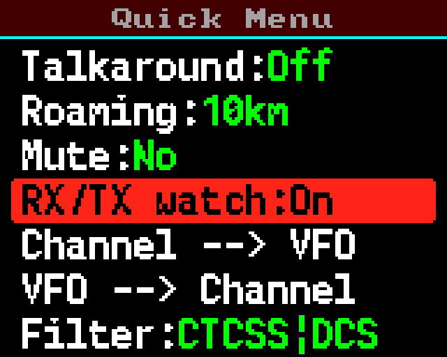
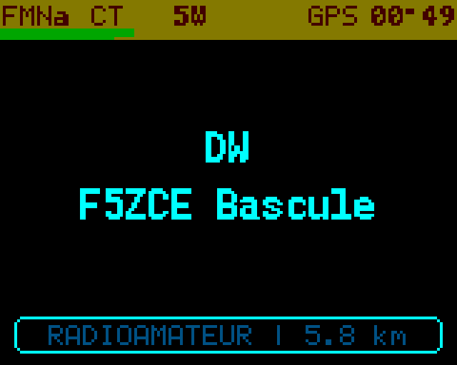
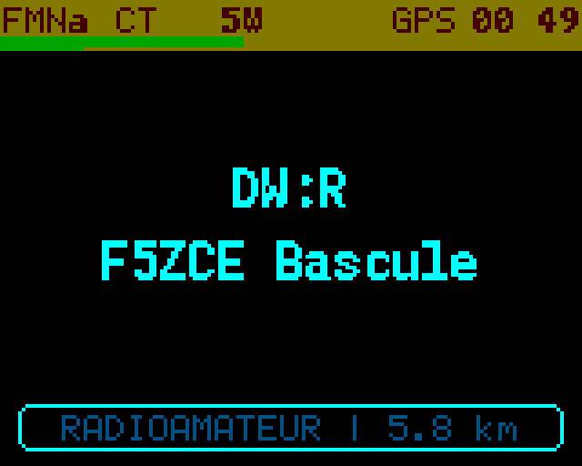
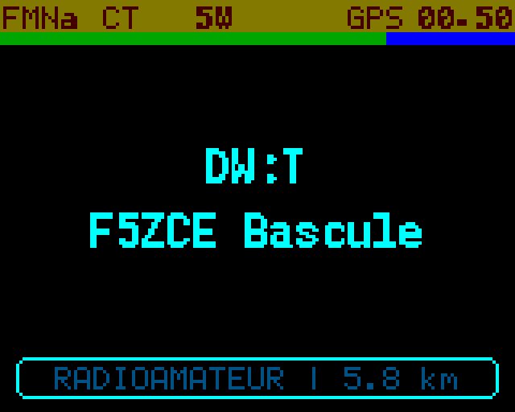
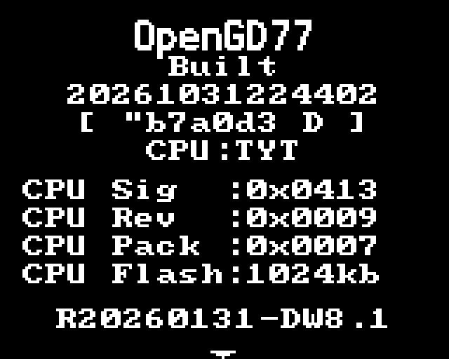
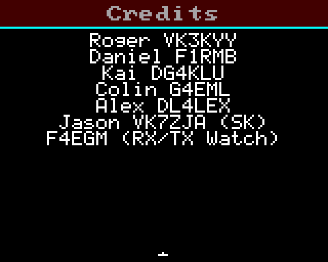
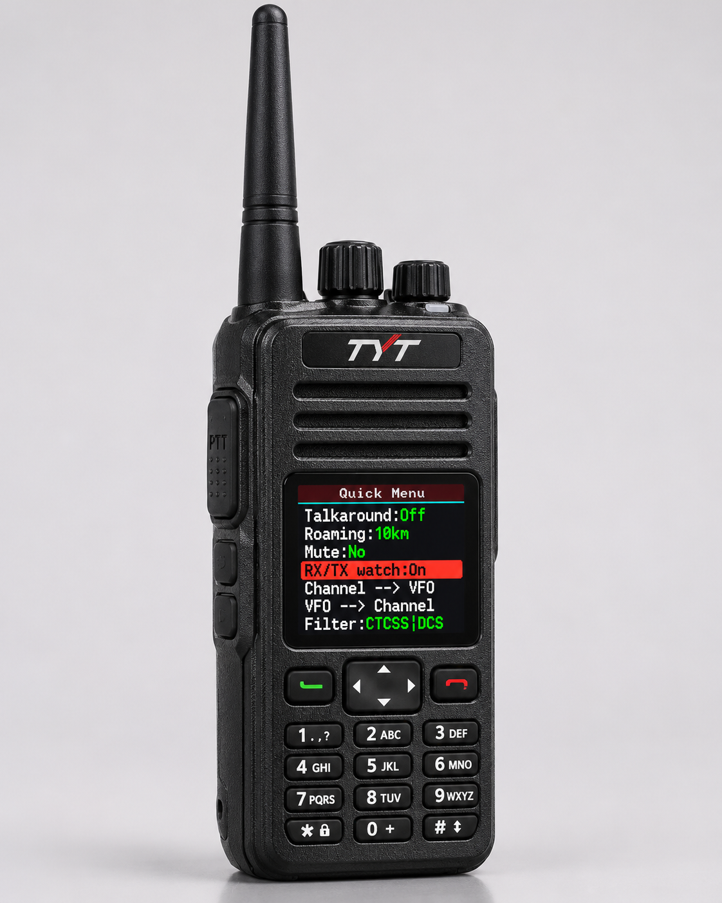

J'utilise **OpenGD77 sur un TYT UV-390 GPS**, également référencé dans la famille MD-UV390. Sur une mémoire de transpondeur, mon poste reçoit la fréquence de sortie et émet sur la fréquence d'entrée. Je voulais pouvoir **écouter les deux fréquences**, sans changer de mémoire ni perdre la fréquence d'émission normale du canal.

Cette modification ajoute un **RX/TX Dual Watch analogique**. Elle a été compilée sur Debian 13, puis **testée sur mon UV-390 GPS avec la version V8.1**. Les essais ont confirmé l'affichage, la commutation entre les deux voies et la conservation du réglage sur plusieurs mémoires après extinction et rallumage.

> **Version concernée :** `R20260131-DW8.1`, adaptation F4EGM d'un fork OpenGD77 basé sur R20260131. Ce n'est pas une version officielle OpenGD77. La protection contre l'interruption des QSO par les balises APRS automatiques est un projet distinct : **elle n'est pas intégrée à cette V8.1**.

## Le cas d'usage : écouter les deux côtés d'un transpondeur

Sur mon canal **F5ZCE Bascule**, le codeplug comporte les deux fréquences suivantes :

| Fonction du canal | Fréquence |
|:---|---:|
| Fréquence RX enregistrée | **432,5375 MHz** |
| Fréquence TX enregistrée | **145,4500 MHz** |

En fonctionnement habituel, le poste reste à l'écoute de 432,5375 MHz. Avec le Dual Watch, il vérifie aussi 145,4500 MHz pour écouter directement les stations qui utilisent l'entrée. Cela ne remplace pas un véritable récepteur à deux voies : l'UV-390 utilise **une seule chaîne de réception**, dont la fréquence est commutée successivement.

## Fonctionnement du Dual Watch



La machine d'états ajoute une alternance entre les deux fréquences stockées dans la mémoire. **Aucune des deux fréquences du codeplug n'est remplacée** par cette opération : la fréquence TX est temporairement utilisée comme seconde fréquence d'écoute.

| Phase | Comportement du firmware |
|:---|:---|
| Recherche sur RX | Écoute de **700 ms** sur la fréquence RX du canal, prioritaire |
| Recherche sur TX | Écoute de **400 ms** sur la fréquence TX du canal |
| Sonde de priorité | **350 ms** sur RX selon l'état de la recherche, avant de retenir une réception sur TX |
| Réception valide | Maintien sur la fréquence reçue jusqu'à fermeture du squelch |
| Fin de réception | Garde de **1 seconde**, puis reprise de la recherche |
| PTT | Utilise la **fréquence TX normale** du canal, même après une réception `DW:T` |

Le décodage CTCSS/DCS configuré côté RX reste appliqué pendant l'écoute des deux fréquences. Le Dual Watch ne transforme pas le poste en émetteur automatique sur la fréquence écoutée : **`DW:T` désigne une réception**, pas une émission.

La fonction est réservée aux mémoires analogiques compatibles, avec fréquences RX et TX différentes. Les fonctions de balayage et les modes incompatibles gardent leur logique habituelle. Le début d'une transmission peut être perdu lorsque le récepteur se trouve temporairement sur l'autre fréquence : c'est une limite de cette solution à une seule chaîne RF.

Une représentation plus technique est également disponible au format [SVG](images/schema-dualwatch-technique.svg).

## Activation dans le Quick Menu

Sur une mémoire analogique admissible, ouvrir le **Quick Menu**, puis sélectionner **RX/TX watch** et choisir **On** ou **Off**.



La version V7 a introduit l'enregistrement du choix **pour chaque mémoire**, et non dans un paramètre global. Je peux activer la fonction sur F5ZCE, la désactiver ailleurs, puis revenir sur la première mémoire. Le réglage reste également présent après redémarrage : je l'ai vérifié sur plusieurs canaux.

### Les trois indications à l'écran



**`DW`** : option active, recherche en cours, aucune réception verrouillée.



**`DW:R`** : réception verrouillée sur la **fréquence RX** du canal.



**`DW:T`** : réception verrouillée sur la **fréquence TX**, utilisée à cet instant comme seconde voie d'écoute. Le poste n'est pas en émission.

La V8 a agrandi cet indicateur en police **8 × 16 pixels**, positionné au-dessus du nom du canal. La ligne du nom du canal et l'en-tête restent inchangés.

## Version V8.1 et crédits

La V8.1 identifie cette variante sur l'écran d'informations du firmware avec la mention **`R20260131-DW8.1`**. Elle ajoute **`F4EGM (RX/TX Watch)`** aux contributeurs sans retirer les crédits présents dans le firmware de départ.





Les six captures précédentes sont issues du **vrai poste**, sous OpenGD77 V8.1. Le matériel utilisé est un **TYT UV-390 GPS**, et non un modèle UV-390 Plus 10 W. Le fichier à flasher porte toutefois le préfixe `MDUV380`, qui correspond à la cible de compilation utilisée pour cette famille.



*Cette image du poste est une **illustration générée**. Elle ne remplace pas une photographie de mon exemplaire. Les six captures d'écran du firmware, elles, proviennent bien du poste testé.*

## Sauvegarde du choix par canal : fonctionnement interne

Dans cette base R20260131, le code de la modification utilise le bit **`0x02`** du champ `LibreDMR_flag1`, situé à l'offset **`0x26`** de l'enregistrement de canal (56 octets). Le format de la mémoire n'est pas agrandi. Une fois On ou Off validé dans le Quick Menu, le firmware sauvegarde le canal par la routine existante `codeplugChannelSaveDataForIndex()`.

Cette sauvegarde n'est **pas** effectuée pendant l'alternance RX/TX : l'écriture n'est demandée qu'à la validation de l'option. Les essais sur poste ont confirmé la persistance de plusieurs activations distinctes au redémarrage.

**Attention au CPS :** un programme de configuration qui ne connaît pas notre bit personnalisé peut le perdre lors d'une réécriture complète du codeplug. Le CPS Web ne propose pas encore d'option dédiée à cette modification. Conserver une sauvegarde avant de réécrire les mémoires.

## Téléchargements V8.1

La compilation ARM V8.1 s'est terminée correctement. J'ai conservé les trois artefacts transmis pour cette version : le binaire, l'ELF et le fichier MAP. Leur empreinte SHA-256 a été revérifiée.

**[Télécharger la release V8.1 complète (BIN + ELF + MAP + empreintes)](downloads/F4EGM_OpenGD77_DualWatch_V81_release_UV390_GPS.zip)**

| Fichier | Rôle | Taille |
|:---|:---|---:|
| [BIN V8.1](downloads/OpenGD77_MDUV380_R20260131_F4EGM_DW_V8_1_EXPERIMENTAL.bin) | Firmware destiné au chargeur compatible OpenGD77 | 806 828 octets |
| [ELF V8.1](downloads/OpenGD77_MDUV380_R20260131_F4EGM_DW_V8_1_EXPERIMENTAL.elf) | Analyse et symboles de compilation | 5 090 912 octets |
| [MAP V8.1](downloads/OpenGD77_MDUV380_R20260131_F4EGM_DW_V8_1_EXPERIMENTAL.map) | Carte de liaison et emplacement des sections | 4 208 197 octets |

**SHA-256 du BIN :**

```text
7a3d1cab1b3eea60726021ebe652d327a2cd496ea1db5e9062eac90bbeaa4003
```

La compilation laisse **106 732 octets de marge Flash** avant la zone réservée au codec AMBE (zone vérifiée à `0xFF` dans l'audit). Les bibliothèques et données de codec propriétaires ne sont pas distribuées dans ce paquet ; le chargeur utilisé doit respecter la procédure de préparation du firmware adaptée à ce modèle.

## Sources d'origine et différences avec la V8.1

**[Télécharger les sources de référence, le diff et les scripts de reconstruction](downloads/F4EGM_OpenGD77_V81_sources_et_diff.zip)**

Le point de départ est un **fork non officiel d'OpenGD77**, conservé au commit :

[`b7a0d368a458291c66e6fb1431d7c78627727381`](https://github.com/mangelajo/opengd77-rt3s-experiments/commit/b7a0d368a458291c66e6fb1431d7c78627727381)

Les sources disponibles ont permis de reconstruire et comparer intégralement **`uiChannelMode.c`** et **`menuSystem.h`** entre la base et V8.1. L'archive contient leurs deux versions, un diff unifié réel, la chaîne de correctifs et le script de reconstruction. Les modifications supplémentaires dans `codeplug.h` et `menuFirmwareInfoScreen.c` sont portées par les scripts fournis, y compris la correction de l'ancre « CPU Flash » pour la V8.1.

**Limite de l'archive :** elle ne contient pas la totalité de l'arborescence amont (elle n'était pas présente dans la sauvegarde reçue). Pour obtenir **la source amont complète, la version modifiée complète et leur diff complet**, le script inclus télécharge le commit épinglé et applique les correctifs :

```bash
# Après extraction de l'archive de sources, sur un PC Linux connecté :
bash ./reconstruire_sources_et_diff_complet.sh
```

Ce script modifie uniquement des copies de sources sur le PC ; il ne flashe pas la radio. Il conserve les deux arborescences et génère `DIFF_COMPLET_ORIGINE_VERS_F4EGM_V81.patch`. La construction du BIN demande ensuite l'outillage ARM/Podman décrit ci-dessous.

## Compiler sous Debian 13

La chaîne utilisée pour mon build est **Podman + GCC ARM bare-metal (`arm-none-eabi`) + Python 3**, avec les scripts de correction et d'audit inclus dans l'archive de sources.

```bash
sudo apt update
sudo apt install -y git python3 unzip podman
```

Pour une compilation à partir de l'arbre OpenGD77 déjà préparé, le correctif V8.1 d'origine et sa correction d'ancre peuvent être appliqués avec les scripts du kit. L'archive de sources contient également un script `build_from_zero_reference.sh` qui montre comment repartir du commit amont. Selon le système, les dépendances ARM sont fournies dans l'environnement de compilation Podman.

Pour contrôler la V8.1 compilée, vérifier la réussite des tests, la taille du BIN et sa somme SHA-256. Un binaire portant le même nom mais une somme différente doit être traité comme un autre build ; le nom ne suffit pas à prouver son identité.

## Sauvegarder le codeplug et envoyer le firmware avec OpenGD77 CPS Web

Le CPS Web que j'utilise fonctionne pour lire les mémoires et charger le firmware : **[grid.radio/opengd77](https://grid.radio/opengd77/)**.

Avant toute mise à jour :

1. En mode de fonctionnement normal, connecter le poste au PC et **lire / exporter le codeplug**. Enregistrer une copie avant modification. Si possible, conserver aussi les réglages et calibrations récupérables par le CPS.
2. Conserver le fichier BIN actuel qui fonctionne, afin de pouvoir revenir à une version antérieure.
3. Pour passer en **DFU**, éteindre le poste puis le rallumer en maintenant **PTT + SK1** avec le câble USB branché. Sous Linux, `lsusb` doit alors afficher un périphérique STM32 DFU, généralement `0483:df11`. Il ne faut pas confondre ce mode avec la lecture du codeplug, qui s'effectue radio allumée normalement.
4. Dans le chargeur de firmware du CPS Web, choisir le **modèle pris en charge pour la famille MD-UV380 / UV-390 standard**, sélectionner le BIN correspondant, fournir le firmware donneur si le chargeur le demande, puis suivre sa procédure d'écriture.
5. Redémarrer et vérifier la page d'informations (`R20260131-DW8.1`), les crédits, puis `DW`, `DW:R`, `DW:T` et le maintien du réglage après extinction.

Ne pas tenter de flasher directement le BIN brut avec `dfu-util` : la préparation des parties réservées au codec doit suivre le parcours du chargeur compatible OpenGD77. Cette variante est destinée à la famille UV-390 GPS standard testée ici, **pas aux variantes Plus 10 W sans validation spécifique**.

## Limites et évolutions séparées

Le Dual Watch partage un seul récepteur et son alternance peut laisser passer une partie du début des appels. Le poste conserve son comportement habituel au PTT. Les essais radio confirment le fonctionnement sur mon UV-390 GPS ; ils ne constituent pas une validation sur toutes les révisions matérielles.

Enfin, **la protection APRS des QSO n'est pas présente dans ce firmware V8.1**. Le SmartBeaconing peut donc encore provoquer une interruption de réception lors d'une balise. Une modification **APRS QSO Guard** fera l'objet d'un article et d'une release distincts, après ses propres essais radio.

## Licence et attribution

Cette adaptation dérive d'OpenGD77 et conserve les droits et crédits du projet d'origine, notamment Roger VK3KYY et Daniel F1RMB. Les fichiers sources et binaires sont soumis aux conditions de redistribution de la licence OpenGD77, dont l'interdiction d'usage commercial. Le texte de licence est inclus dans les archives de téléchargement.

**73, F4EGM**
