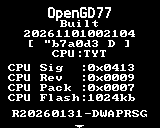
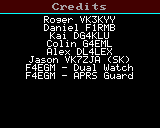

J'utilise un **TYT UV-390 GPS**, sous OpenGD77, notamment pour les réseaux de transpondeurs et de relais interconnectés. J'ai apporté deux modifications au firmware : **Dual Watch RX/TX**, pour écouter alternativement les fréquences de réception et d'émission d'un canal analogique, et **APRS Guard**, pour éviter qu'une balise APRS automatique coupe une réception en cours.

La version combinée affiche **`R20260131-DWAPRSG`** et repose sur **OpenGD77 R20260131**. Elle a été **testée sur mon TYT UV-390 GPS standard**. Je n'ai pas validé les autres modèles, notamment le UV-390 Plus 10 W.

**[Télécharger le firmware et consulter les fichiers de la release DWAPRSG V2 sur GitHub](https://github.com/Telectroboy/OpenGD77_Mods/releases/tag/DWAPRSG_V2)**

Les binaires et les sources sont hébergés sur GitHub et non sur ce site, afin de limiter l'espace utilisé sur l'hébergement OVH.

## 1. Dual Watch RX/TX : surveiller les deux fréquences du canal

Sur un relais ou un transpondeur, la fréquence RX programmée dans le poste est différente de la fréquence TX. Habituellement, on écoute uniquement la fréquence RX, c'est-à-dire la sortie du relais. Il est pourtant parfois intéressant d'entendre aussi un correspondant sur la fréquence d'entrée, par exemple s'il se trouve à proximité ou dans un réseau de transpondeurs reliés.

Mon Dual Watch fait alterner le récepteur entre les deux fréquences du **même canal analogique**. Lorsqu'un signal valide est détecté, le poste s'arrête sur la fréquence correspondante pour permettre l'écoute. Le PTT conserve la fréquence TX normale du canal.

Les indications visibles sur le poste sont :

| Indicateur | Signification |
|---|---|
| `DW` | Double écoute active, alternance des fréquences |
| `DW:R` | Réception d'un signal sur la fréquence RX du canal |
| `DW:T` | Réception d'un signal sur la fréquence TX du canal |

La fonction se commande avec **`RX/TX watch: On / Off`** dans le Quick Menu. Le réglage est conservé individuellement pour chaque canal.

Il ne s'agit **pas de deux récepteurs indépendants** : le poste alterne rapidement entre les fréquences. Un signal très bref peut donc être manqué pendant que le récepteur écoute l'autre fréquence.

## 2. APRS Guard : ne plus interrompre un QSO pour envoyer une balise

### Le problème d'origine

Avec les balises APRS automatiques (**Auto** ou **SmartBeaconing**), OpenGD77 pouvait décider de transmettre sur la fréquence APRS alors que je recevais un QSO. Le poste quittait alors la fréquence écoutée et faisait perdre une partie de la conversation.

### La modification

Le firmware contrôle l'activité radio **avant de lancer le changement de fréquence nécessaire à la balise APRS automatique** :

1. Une balise APRS devient due pendant qu'un signal est reçu ou pendant que le PTT est actif.
2. La balise est **mise en attente**, sans être supprimée.
3. À la fermeture du squelch et une fois le PTT relâché, une courte garde de **500 ms** s'applique. Une activité qui reprend réinitialise cette garde.
4. Une balise précédemment reportée peut être reconsidérée toutes les **100 ms**. Dès que les conditions sont réunies, l'envoi peut démarrer.

Le but n'est pas d'attendre la fin supposée de l'intégralité du QSO. Il est de **profiter d'un blanc entre deux passages**, sans interrompre quelqu'un qui parle.

L'APRS manuel et les émissions APRS déclenchées au relâchement du PTT conservent leur fonctionnement antérieur. Les autres contrôles normaux d'émission APRS restent en place.

### Résultats des essais sur le poste

**Tests effectués sur mon UV-390 GPS :**

- Aucune transmission APRS automatique pendant la réception **`DW:R`**.
- Aucune transmission APRS automatique pendant la réception **`DW:T`**.
- Lorsque le squelch se referme, une balise déjà due part **très rapidement après**.

Ces trois comportements ont été constatés sur la radio, et pas seulement en simulation logicielle. La modification **APRS Guard est donc validée sur mon UV-390 GPS pour ces scénarios**. Je n'ai pas mesuré à l'oscilloscope le délai complet entre fermeture du squelch et début RF de la trame : les 500 ms et 100 ms sont les valeurs programmées, et non une mesure de temps d'antenne.

Une limite demeure : pendant que le poste émet son paquet APRS, il ne peut pas écouter simultanément le QSO. Une nouvelle prise de parole qui survient durant cette émission peut être manquée.

## 3. Identifier la version installée

Dans **Firmware Info**, la version combinée est identifiée par **`R20260131-DWAPRSG`**.

Dans les **Credits**, les mentions suivantes identifient les deux modifications : `F4EGM - Dual Watch` et `F4EGM - APRS Guard`.

La chaîne `DWAPRSG` remplace les anciennes références de développement (`DW8.1`, `RC2`) dans l'affichage utilisateur. Elle permet de distinguer le firmware combiné de la précédente version Dual Watch seule.

## 4. Installation et précautions

Le firmware publié est une **modification non officielle d'OpenGD77**. Je l'ai testé sur **TYT UV-390 GPS standard uniquement** ; la compatibilité avec d'autres variantes n'est pas établie.

Avant toute installation, sauvegardez le codeplug et conservez le firmware actuellement fonctionnel. Utilisez un outil de chargement compatible OpenGD77 en sélectionnant précisément votre modèle de radio. Une mauvaise variante de firmware peut empêcher un démarrage normal.

**[Release GitHub DWAPRSG V2 : téléchargements, sources et fichiers associés](https://github.com/Telectroboy/OpenGD77_Mods/releases/tag/DWAPRSG_V2)**

Pour mémoire, l'APRS Guard intervient sur les balises automatiques et SmartBeaconing. Il ne garantit pas qu'une trame APRS entière se terminera avant la prochaine émission vocale d'un correspondant.

## 5. Ce qui a été vérifié

| Fonction | État |
|---|---|
| Dual Watch RX/TX sur UV-390 GPS | Testé sur le poste |
| Réception `DW:R` et `DW:T` | Testée sur le poste |
| Absence de départ APRS automatique pendant ces réceptions | Testée sur le poste |
| Départ rapide d'une balise due après fermeture du squelch | Observé sur le poste |
| Identifiant `R20260131-DWAPRSG` et crédits | Vérifiés sur captures du poste |
| Autres modèles de radios | Non testés |

Le projet et les releases se trouvent sur **[GitHub : Telectroboy/OpenGD77_Mods](https://github.com/Telectroboy/OpenGD77_Mods)**. Les retours d'utilisation sur d'autres configurations sont les bienvenus, en précisant le modèle exact et le comportement constaté.

**73, F4EGM**
