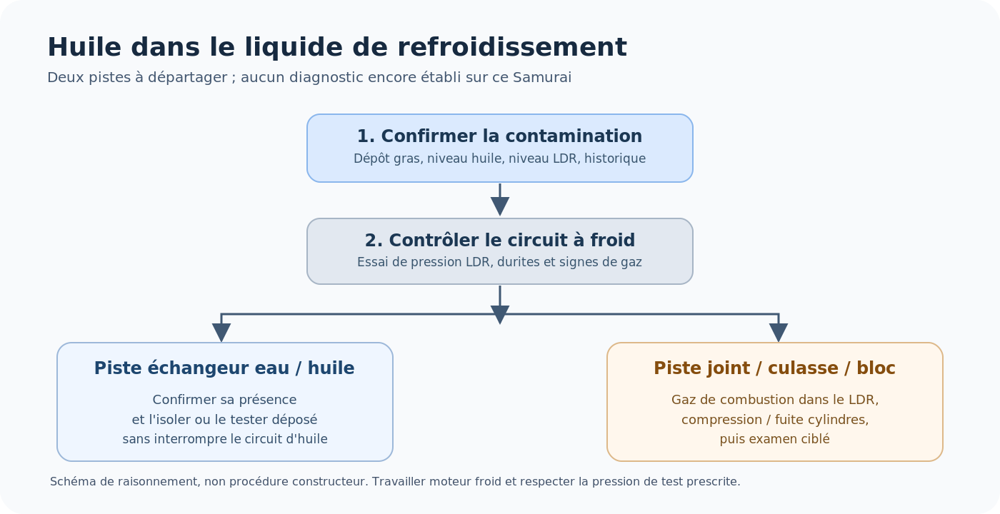

Mon père est tombé en panne avec son **Suzuki Samurai 1.9 D de 2001**, équipé d'une **pompe d'injection Lucas EPIC phase III**. Le moteur entraîné par le démarreur refusait de partir. Le gazole arrivait à la pompe, mais je n'observais pas de carburant refoulé vers les injecteurs.

Cela ressemblait à une panne de pompe. Après plusieurs recherches, le responsable s'est avéré être **le capteur de position du vilebrequin (PMH)** : l'ancien affichait **plus de 2 MΩ**, tandis que le nouveau mesurait **environ 700 Ω**. Un **VALEO 254017 acheté 16 € sur Amazon** et remplacé en quelques minutes a remis le moteur en route.

J'ai conservé ici le déroulement du diagnostic, les références réellement photographiées, les documents Lucas/Delphi EPIC et la liste des pièces de réparation repérées. À la fin, je prépare aussi la prochaine investigation : **de l'huile apparaît dans le liquide de refroidissement**. Son origine n'est pas encore identifiée.

## Le véhicule et la panne

| Élément | Référence ou constat |
|---|---|
| Véhicule | Suzuki Samurai 1.9 D, première mise en circulation le **23 juillet 2001** |
| Type | **SJS04** |
| Propriétaire | Mon père |
| Moteur | Renault 1.9 diesel ; **inscription F8T relevée sur le moteur**, indice exact à confirmer |
| Pompe | **Lucas EPIC R8640A111B**, marquage **EPIC H11.027** |
| Symptôme | Démarreur fonctionnel, pas de démarrage ; gazole présent à l'arrivée de pompe, pas de refoulement observé aux injecteurs |
| Réparation | **Capteur PMH VALEO 254017**, **16 €**, quelques minutes |

*Le Samurai de mon père, avec sa remorque, sur un pont artisanal en rondins. Photo personnelle.*

*Une vue plus générale du même pont. Photo personnelle.*

**F8T ou F8Q ?** J'ai trouvé le marquage **F8T** sur le moteur. Les catalogues du Samurai 1.9 D de cette période utilisent aussi les désignations **F8Q/NF8Q**. Je ne déduis pas l'indice moteur complet de la seule inscription repérée : il faudra le vérifier sur la plaque ou le marquage d'identification moteur. La **référence de la pompe**, en revanche, a été photographiée et ne prête pas à confusion. Les notes Renault F8Q citées ci-dessous servent donc de documentation de la *famille technique* et ne sont pas présentées comme le manuel propre à ce Samurai.

## Pourquoi la pompe Lucas EPIC était suspecte

À la mise du contact, j'entendais un petit **« tic »**. Je pensais à l'électrovanne STOP de la pompe, sans pouvoir affirmer que c'était elle. Ce bruit ne confirme ni l'ouverture du STOP, ni la présence d'une commande d'injection correcte.

### La référence relevée sur la pompe

*Plaque de la pompe réellement montée, Lucas **R8640A111B**, EPIC **H11.027**. La photographie a été réorientée pour permettre la lecture.*

La Lucas EPIC est une **pompe distributrice entraînée mécaniquement par la distribution**, mais dont le débit, l'avance et l'arrêt sont pilotés par un calculateur. Il faut donc distinguer un défaut hydraulique dans la pompe, un défaut de commande et une information moteur absente. [Présentation technique de la régulation EPIC (Innovauto)](https://www.innovauto.org/diesel/la-regulation-electronique-diesel-des-pompes-epic-delphi).

### Le capteur de position du rotor que j'avais démonté

*Photo personnelle : référence **9160-114A** du capteur de position du rotor, monté entre les sorties haute pression de la pompe. [Fiche de la pièce chez Liron](https://www.liron.fr/capteur-rotor-lucas-epic-iii-9160-114a-rp-c2x40472778).*

J'avais déposé ce bloc maintenu par **deux vis**. En actionnant ensuite le démarreur, **du gazole sortait de son logement ouvert**. Cette observation pouvait faire penser que l'électrovanne STOP était ouverte. Mais elle ne prouvait en réalité que la présence de gazole à cet endroit : **pas l'autorisation d'injecter, ni le refoulement correct vers les cylindres**.

> Cet essai est rapporté pour comprendre la fausse piste, **pas comme une méthode de contrôle recommandée**. Démonter un composant d'injection introduit un risque de contamination et de fuite. Le remplacement ou le réglage de certains capteurs EPIC nécessite un banc d'essai spécialisé.

## Comment fonctionne la pompe EPIC phase III

### Vue éclatée Delphi d'origine

*Planche Delphi **EPIC IDI (098), juin 1999, 4/7**. Cette vue est **partielle** : elle détaille essentiellement la tête de pompe, les joints, les capteurs et leurs fixations. [Page d'origine, DieselGarage](https://www.dieselgarage.com.ua/9160-113a-delphi-datchik-operezeniya-epic-kangoo).*

L'ensemble repéré **761**, à droite, correspond au capteur de rotor présenté par les fournisseurs sous la référence **9160-114A**. Le capteur latéral d'avance/de came est disponible sous la référence **9160-113A**. Les deux ne sont pas interchangeables, et aucun ne doit être confondu avec le PMH monté sur le moteur.

### Circuit hydraulique : ce que commande le calculateur

*Schéma technique du circuit hydraulique EPIC, [diffusé dans une discussion sur Forum Auto](https://forum-auto.caradisiac.com/topic/337762-kangoo-express-reprise-v%C3%A9hicule-apr%C3%A8s-immobilisation-panne-apr%C3%A8s-1-semaine/). Auteur et édition originale non identifiés. Il illustre le principe de la famille EPIC, pas un schéma de câblage propre au SJS04.*

1. **Alimentation et transfert.** Le gazole traverse le circuit d'alimentation, puis la pompe à palettes établit une pression de transfert régulée.
2. **Création et distribution de la pression.** Le rotor distributeur et les pistons plongeurs, entraînés par les galets sur l'anneau à cames, compriment le carburant et l'envoient successivement vers les injecteurs.
3. **Régulation du débit.** Les électrovannes **Débit +** et **Débit −** modifient les pressions de commande qui déplacent le rotor. Sa position modifie le volume utile et donc la quantité injectée. Le calculateur vérifie ce déplacement avec le **capteur de position du rotor**.
4. **Régulation de l'avance.** L'électrovanne d'avance pilote le piston qui oriente l'anneau à cames. Le **capteur de position de came/avance** permet au calculateur de contrôler le résultat.
5. **Arrêt.** L'électrovanne **STOP** commande l'autorisation de passage du gazole dans le circuit d'injection. Le système peut être rempli de carburant sans produire d'injection normale.

*Vue technique de la commande du rotor. [Innovauto, « La régulation électronique diesel des pompes EPIC Delphi »](https://www.innovauto.org/diesel/la-regulation-electronique-diesel-des-pompes-epic-delphi).*

Le **capteur PMH**, au niveau du volant moteur, est une entrée du calculateur distincte des deux capteurs de la pompe. Sans information de régime exploitable, l'injection ne peut pas être pilotée normalement. C'est ce qui rendait crédible une panne de pompe alors que le capteur extérieur était défectueux.

### Notice de réparation du capteur rotor et cales

La [notice technique de réparation du capteur rotor, disponible chez AutoDiesel13 (PDF, 3 pages)](https://www.autodiesel13.com/upload/notice_compensation_epic.pdf) comporte des **dessins originaux** qui montrent la localisation du capteur, sa dépose et les cales de compensation de son noyau.

<!-- EPIC_PDF_FIGURES_BEGIN -->
- [Voir la planche d'origine du capteur de rotor, page 2 du PDF Renault](https://www.autodiesel13.com/upload/notice_compensation_epic.pdf#page=2).
- [Voir la planche d'origine du noyau et des cales (repères 7 et 8), page 3 du PDF Renault](https://www.autodiesel13.com/upload/notice_compensation_epic.pdf#page=3).

*Ces deux extraits peuvent être automatiquement intégrés comme images locales en exécutant l'installateur fourni dans l'archive Hugo.*
<!-- EPIC_PDF_FIGURES_END -->

La procédure concerne un **cas diagnostiqué**, notamment le défaut **DF066** sur certaines applications Renault. Le **kit de compensation 9109-934** sert à corriger une dérive de lecture de position du rotor en ajoutant une cale prévue pour cela. Il ne s'agit ni d'un réglage systématique ni d'une opération nécessaire à la réparation du Samurai. Dans notre cas, la panne venait du PMH moteur.

### Pièces identifiées pour cette pompe

| Référence | Désignation | Document ou fournisseur |
|---|---|---|
| **R8640A111B** | Pompe Lucas EPIC phase III photographiée | Plaque du véhicule |
| **9109-770 / ED770** | Pochette de joints EPIC phase III | [AutoDiesel13](https://www.autodiesel13.com/pochettes-de-joints-36/pochette-de-joint-pompe-injection-8422.html) |
| **9109-934** | Kit de compensation du capteur rotor | [AutoDiesel13](https://www.autodiesel13.com/pochettes-de-joints-36/kit-de-compensation-epic-phase-11214.html) |
| **9160-114A** | Capteur de position rotor, photographié | [AutoDiesel13](https://www.autodiesel13.com/divers-32/capteur-rotor-epic-renault-clio-14742.html) / [Liron](https://www.liron.fr/capteur-rotor-lucas-epic-iii-9160-114a-rp-c2x40472778) |
| **9160-113A** | Capteur de position d'avance/de came (avec sonde de température) | [Liron](https://www.liron.fr/capteur-avance-lucas-epic-iii-9160-113a-c6x19510915) |

Ces références sont données **pour documenter** les possibilités de réparation de la pompe, pas comme une liste de pièces remplacées. [Le manuel d'atelier Lucas EPIC IDI XNB118(F), édition 1996 (Scribd)](https://fr.scribd.com/doc/285870839/236886839-Manual-Reparatie-Pompa-Lucas-Epic) porte sur la famille EPIC, avec des variantes plus anciennes : ne pas transposer automatiquement ses réglages à la phase III.

## Le vrai défaut : capteur PMH coupé

Le PMH est installé à la jonction moteur-boîte, en regard du **volant moteur**. Il fournit au calculateur les informations de vitesse et de position du vilebrequin.

*La pièce noire au centre est le **VALEO 254017 neuf**, monté à proximité du volant moteur. Photo personnelle recadrée.*

[Voir aussi le plan large de la zone du capteur PMH](pmh-nouveau-vue-ensemble.jpg).

*Schéma fonctionnel explicatif. Ce n'est pas le plan de câblage Suzuki.*

### Les deux mesures électriques

| Capteur testé, débranché | Mesure effectuée |
|---|---:|
| **Ancien capteur PMH** | **Plus de 2 MΩ** |
| **Nouveau VALEO 254017** | **Environ 700 Ω** |
| **Fiche commerciale VALEO 254017** | **700 Ω nominal** |

Le vieux PMH était **très sale**, mais sans trace visible de rupture. Une valeur de plusieurs mégohms, comparée à la valeur nominale du neuf, est compatible avec une **coupure électrique du bobinage ou de sa connexion**. L'ohmmètre ne permet pas de situer exactement cette coupure.

À l'inverse, **700 Ω ne prouvent pas à eux seuls que le signal est bon pendant le démarrage** : une panne intermittente peut demander un contrôle à l'oscilloscope, capteur monté et moteur entraîné au démarreur.

### VALEO 254017, la pièce remplacée

*Photo commerciale : [VALEO 254017, Piècesauto24](https://www.piecesauto24.com/valeo/9386186). Capteur inductif, deux broches, sans câble intégré, résistance nominale annoncée **700 Ω**. La photo catalogue reste hébergée chez le fournisseur.*

*Fiche graphique réalisée pour l'article ; elle ne remplace pas les données constructeur. Ne pas appliquer 12 V aux deux bornes de ce capteur inductif passif.*

La [note Renault NT 3163A, janvier 1999, F8Q 622 avec Lucas EPIC](https://pdfcoffee.com/3163a-particularites-moteur-f8q-622-pdf-free.html) donne pour **son application** un capteur de régime d'environ **650 Ω** (page 13-2). Ce chiffre ne contredit pas les **700 Ω** indiqués pour la référence VALEO achetée. Il faut comparer une mesure à la **bonne référence de capteur**, pas appliquer une valeur unique à toutes les variantes.

*Synthèse originale des informations documentaires Renault et VALEO, distinctes des mesures personnelles.*

*Coupe générique d'un capteur inductif : bobine (1), noyau (2), aimant (3), sortie (4). Illustration de [Tamasflex, Wikimedia Commons](https://commons.wikimedia.org/wiki/File:Crankshaft_sensor.png), sous licence [CC BY-SA 3.0](https://creativecommons.org/licenses/by-sa/3.0/).*

### Remplacement et résultat

J'ai commandé un **VALEO 254017 pour 16 € sur Amazon**. Le changement a pris **quelques minutes**, puis le Samurai de mon père a redémarré et fonctionne de nouveau. La **pompe EPIC R8640A111B n'a pas été remplacée**.

Pour une panne comparable, je commencerais désormais par contrôler le PMH avant d'ouvrir la pompe : connecteur et câblage, résistance du capteur débranché, fixation en regard du volant moteur et, si besoin, signal à l'oscilloscope pendant que le démarreur tourne. Ensuite seulement viendraient les contrôles des alimentations et commandes de la pompe.

**Bilan : plus de 2 MΩ sur l'ancien, environ 700 Ω sur le neuf, et une réparation à 16 €.** La piste de la pompe paraissait plausible, mais c'est une mesure électrique simple qui a tranché.

## Prochaine panne à étudier : de l'huile dans le liquide de refroidissement

Le moteur tourne à nouveau, mais **j'ai constaté de l'huile dans le circuit de refroidissement**. Le diagnostic n'est pas encore effectué. Deux origines sont à examiner en priorité : **l'échangeur eau/huile, s'il est présent sur cette configuration**, et une **communication anormale entre les circuits à travers le joint de culasse, la culasse ou le bloc**. La présence d'huile dans le vase ne suffit pas à choisir entre ces causes. Dans un échangeur percé, **la pression d'huile en fonctionnement peut pousser l'huile dans le LDR** ; cela explique pourquoi on peut trouver de l'huile dans l'eau sans retrouver aussitôt de l'eau dans l'huile. **Ce sens de migration n'est pas une preuve**, car d'autres fuites internes sont possibles.

*Ordre de recherche envisagé, non procédure constructeur et sans résultat encore acquis sur le Samurai.*

### Ce que je vais contrôler avant de démonter

1. **Confirmer la nature du dépôt.** Photographier le vase, vérifier que le film surnageant est effectivement gras, noter les niveaux de liquide de refroidissement et d'huile et surveiller leur évolution. Un liquide brun n'est pas à lui seul une preuve de mélange huile/eau.
2. **Contrôler l'huile moteur.** Observer la jauge et le bouchon, rechercher une émulsion et surtout une montée anormale du niveau. L'absence de « mayonnaise » ne suffit pas à exclure un passage d'huile vers le liquide de refroidissement.
3. **Observer la pression des durites moteur froid puis au démarrage.** Des durites qui se durcissent **très vite à froid**, avec bulles persistantes dans le vase ou rejet de liquide, orienteraient vers des gaz de combustion dans le LDR. À chaud, un circuit sous pression est normal : **une durite dure ne prouve pas à elle seule un joint de culasse**.
4. **Faire un test d'étanchéité du circuit de refroidissement à froid**, avec la pompe et l'adaptateur de bouchon adaptés. Ne pas dépasser la pression prescrite pour ce véhicule. Chercher une baisse de pression et des fuites, puis contrôler si du liquide migre vers l'huile ou les cylindres.
5. **Identifier physiquement l'échangeur eau/huile.** Vérifier s'il existe un petit échangeur monté près du filtre à huile, avec des arrivées et retours de LDR. Ne pas présumer de sa présence à partir des seules références d'autres moteurs Renault ou Samurai.
6. **Tester l'échangeur en priorité s'il existe.** L'idéal est une **dépose puis un test séparé d'étanchéité** entre ses passages d'huile et d'eau. Une fuite interne sur l'échangeur expliquerait de l'huile dans le LDR sans imposer d'emblée une dépose de culasse.
7. **Rechercher des gaz de combustion**, avec un test chimique CO₂ dans le vase, puis, si les indices convergent, des tests de compression et/ou d'étanchéité des cylindres. Un résultat négatif au CO₂ ne suffit pas, à lui seul, à innocenter un joint de culasse qui ne fuit qu'entre une galerie d'huile et le LDR.

### Peut-on shunter provisoirement l'échangeur ?

C'est une **piste de vérification**, mais il faudra d'abord photographier et identifier exactement son montage. Sur un échangeur doté de deux durites de refroidissement indépendantes, il peut être envisageable de **raccorder temporairement les deux durites côté LDR** pour isoler le passage d'eau de l'échangeur. Cela ne doit jamais interrompre le **circuit d'huile sous pression**. Il faut préserver la circulation du LDR et l'étanchéité, tenir compte du refroidissement perdu et limiter un éventuel essai en marche. **Une mise à l'épreuve de l'échangeur déposé reste préférable.**

Je ne prévois **aucun roulage prolongé** avec un échangeur neutralisé. Un essai de cette nature ne devrait être réalisé qu'après identification sûre des circuits, moteur froid au montage, puis sous surveillance des températures et des fuites. Si le système sur ce Samurai ne permet pas d'isoler proprement l'échangeur, cette méthode sera écartée.

### Comment départager les deux hypothèses ?

| Observation ou essai | Ce que cela suggère, sans suffire seul |
|---|---|
| Huile dans le LDR, mais huile moteur d'aspect normal | Compatible avec une fuite interne de l'échangeur ; également possible dans certaines fuites joint/culasse |
| Échangeur déposé qui laisse communiquer huile et eau au test d'étanchéité | **Échangeur défectueux confirmé** |
| Pression et bulles précoces à froid, test CO₂ positif | Présence de gaz de combustion, qui oriente vers joint, culasse ou autre communication avec un cylindre |
| Test CO₂ négatif | Ne permet pas d'exclure un défaut limité à une galerie d'huile |
| Fuite aux tests de cylindres et autres éléments concordants | Piste joint de culasse, culasse ou bloc à investiguer |
| Dépôt d'huile persistant après réparation | Peut simplement être de l'huile résiduelle ; vérifier après nettoyage et surveillance des niveaux |

**Sécurité :** ne jamais ouvrir un bouchon de refroidissement moteur chaud ou sous pression. Si le moteur surchauffe, rejette du liquide, perd sa lubrification ou présente du LDR dans l'huile, arrêter les essais. Une fois la cause réparée, le circuit de refroidissement devra être nettoyé : l'huile résiduelle peut rester dans le radiateur, le chauffage, les durites et le vase d'expansion.

**État de cette deuxième recherche au 27 octobre 2026 :** présence d'huile signalée dans le LDR ; ni échangeur ni joint de culasse diagnostiqués. Les contrôles ci-dessus restent **à réaliser et à documenter**. Les procédures [Mercedes-Benz (bulletin technique 2019, moteurs différents)](https://static.nhtsa.gov/odi/tsbs/2019/MC-10164297-9999.pdf) et [Detroit Diesel (bulletin 2013 sur huile dans LDR)](https://static.nhtsa.gov/odi/tsbs/2013/MC-10140894-9999.pdf) confirment l'intérêt de contrôler l'échangeur et son étanchéité avant d'attribuer automatiquement la pollution au joint de culasse. Ces bulletins **ne sont pas des consignes constructeur pour le Samurai**.

## Documents, sources et crédits des images

**Documents injection et pièces EPIC :**

- [Renault NT 3163A (1999), F8Q 622 / pompe Lucas EPIC](https://pdfcoffee.com/3163a-particularites-moteur-f8q-622-pdf-free.html) : caractéristiques, organes, fonctionnement et capteur de régime (application Renault différente).
- [Delphi, éclaté EPIC IDI (098), 06/1999, planche 4/7](https://www.dieselgarage.com.ua/9160-113a-delphi-datchik-operezeniya-epic-kangoo) : reproduction hébergée par DieselGarage.
- [Schéma hydraulique EPIC diffusé sur Forum Auto](https://forum-auto.caradisiac.com/topic/337762-kangoo-express-reprise-v%C3%A9hicule-apr%C3%A8s-immobilisation-panne-apr%C3%A8s-1-semaine/) : édition et auteur originaux non identifiés.
- [Notice de réparation du capteur rotor, PDF 3 pages (AutoDiesel13)](https://www.autodiesel13.com/upload/notice_compensation_epic.pdf) : montage et cales de compensation ; intervention conditionnelle, notamment après diagnostic DF066.
- [Innovauto, La régulation électronique diesel des pompes EPIC Delphi](https://www.innovauto.org/diesel/la-regulation-electronique-diesel-des-pompes-epic-delphi) : fonctionnement du rotor, des électrovannes et de l'avance.
- [Manuel d'atelier Lucas EPIC IDI XNB118(F), 1996 (Scribd)](https://fr.scribd.com/doc/285870839/236886839-Manual-Reparatie-Pompa-Lucas-Epic) : document historique, certaines variantes plus anciennes.
- [AutoDiesel13, pochette de joints ED770 / 9109-770](https://www.autodiesel13.com/pochettes-de-joints-36/pochette-de-joint-pompe-injection-8422.html), [kit de compensation 9109-934](https://www.autodiesel13.com/pochettes-de-joints-36/kit-de-compensation-epic-phase-11214.html), [capteur de rotor 9160-114A](https://www.autodiesel13.com/divers-32/capteur-rotor-epic-renault-clio-14742.html).
- [Liron, 9160-114A](https://www.liron.fr/capteur-rotor-lucas-epic-iii-9160-114a-rp-c2x40472778) et [9160-113A](https://www.liron.fr/capteur-avance-lucas-epic-iii-9160-113a-c6x19510915).

**Capteur PMH :** [VALEO 254017 et caractéristiques](https://www.piecesauto24.com/valeo/9386186), [référencement Samurai 1.9 D dans le catalogue](https://www.pieces24.be/suzuki/samurai-sj/25511/15032/capteur-pmh). Le prix **16 €** est celui réellement payé pour le remplacement, pas un tarif catalogue actuel.

**Recherches à venir :** [Bulletin Mercedes-Benz, huile dans le circuit LDR](https://static.nhtsa.gov/odi/tsbs/2019/MC-10164297-9999.pdf) ; [bulletin Detroit Diesel, contrôle d'échangeur](https://static.nhtsa.gov/odi/tsbs/2013/MC-10140894-9999.pdf). Ces sources documentent une logique de diagnostic, **pas l'équipement exact de ce véhicule**.

**Crédits :** photos du Samurai de mon père, de la pompe, du capteur rotor et du PMH : photographies personnelles. Figures historiques : Delphi/DieselGarage, schéma EPIC repris via Forum Auto, extraits du PDF Renault/AutoDiesel13 et illustrations Innovauto, avec sources indiquées au fil de l'article. Photo produit : catalogue Piècesauto24. Coupe générique de capteur : Tamasflex, Wikimedia Commons, CC BY-SA 3.0. Schémas d'aide au diagnostic et comparatifs : illustrations originales réalisées pour cet article. La consultation publique de documents constructeur ne vaut pas cession de leurs droits de reproduction.
