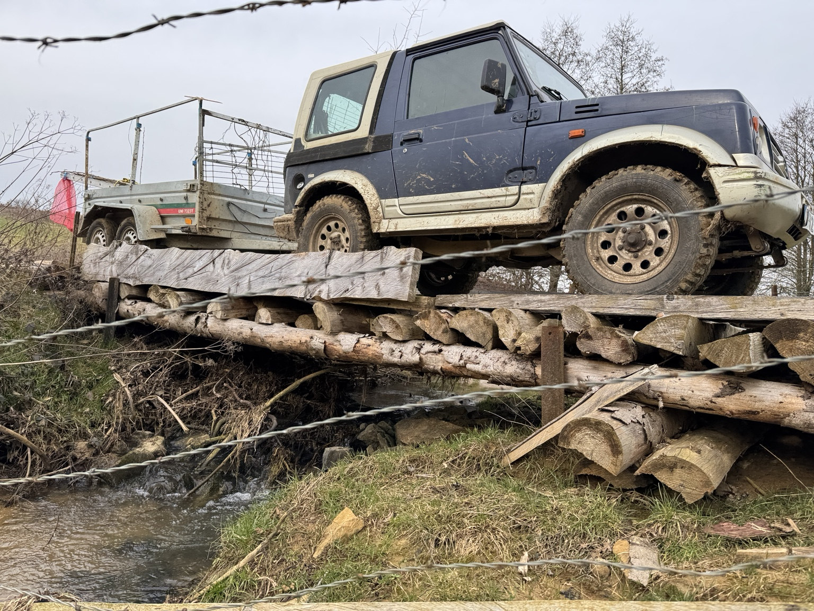
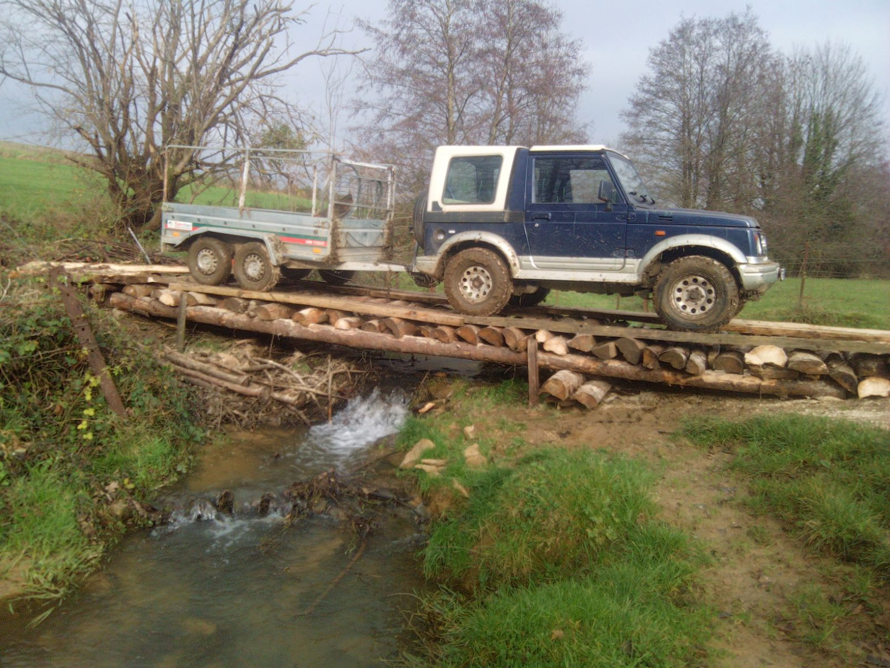
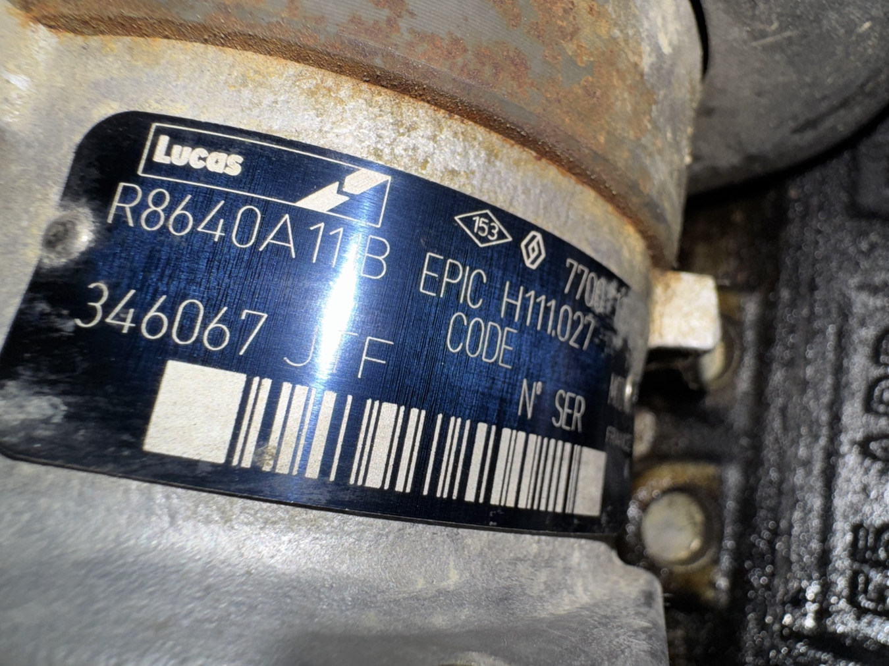
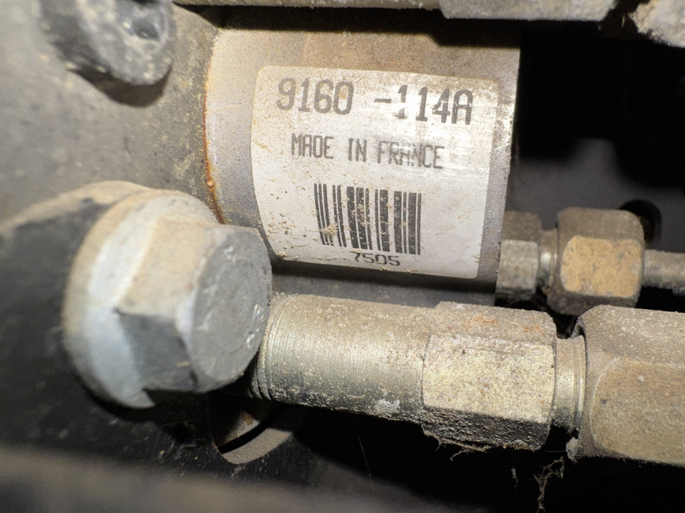
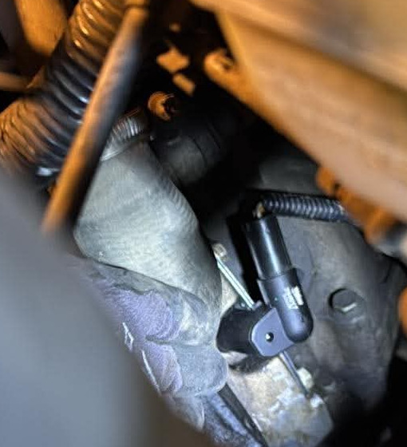
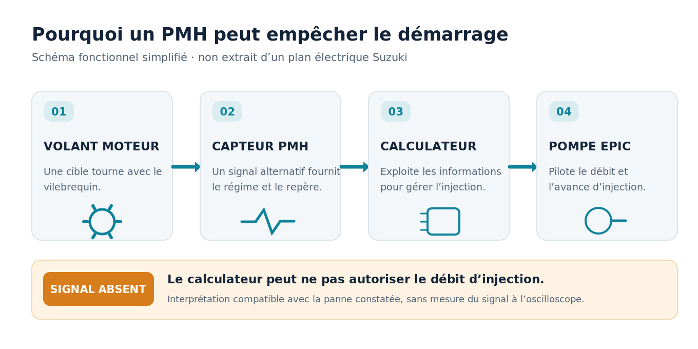
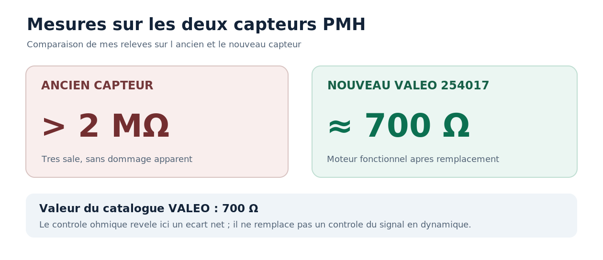
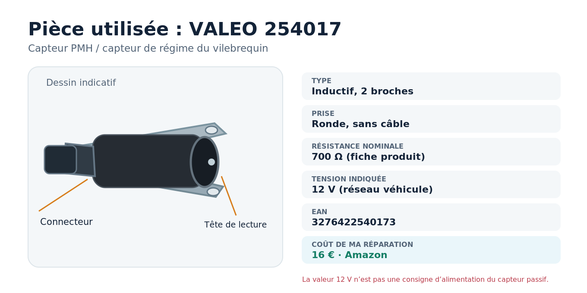
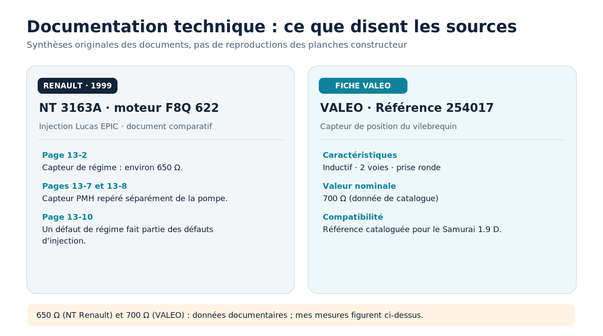

Mon **Suzuki Samurai 1.9 D de 2001**, équipé du moteur diesel Renault **F8Q** et d'une pompe d'injection **Lucas EPIC**, refusait de redémarrer. Le gazole arrivait à la pompe, mais je ne constatais pas de débit vers les injecteurs. Tout orientait vers une panne de l'injection.

Au final, il n'a fallu **ni remplacer ni faire réparer la pompe**. La panne venait du **capteur de position du vilebrequin (PMH)**. Un **VALEO 254017 acheté 16 € sur Amazon**, monté en quelques minutes, a permis au moteur de repartir.

La mesure électrique, effectuée sur l'ancien et le nouveau capteur, est particulièrement parlante : **plus de 2 MΩ pour le capteur hors service, contre environ 700 Ω pour le neuf**.

## Le véhicule et les symptômes

| Élément | Référence / constat |
|---|---|
| Véhicule | Suzuki Samurai 1.9 D, mis en circulation le 23 juillet 2001 |
| Type | SJS04 |
| Moteur | Renault F8Q diesel |
| Pompe d'injection | Lucas EPIC, référence relevée **R8640A111B** |
| Problème | Le moteur ne démarre plus ; gazole à l'arrivée de la pompe, aucun débit observé vers les injecteurs |
| Pièce responsable | Capteur PMH / capteur de régime moteur |
| Remplacement | **VALEO 254017**, 16 €, quelques minutes |

*Mon Suzuki Samurai 1.9 D, photographié avec sa remorque sur un pont artisanal en rondins. Photo personnelle.*

*Deuxième vue du même franchissement, montrant le 4×4, la remorque et l'ensemble du pont. Photo personnelle.*

À la mise du contact, un petit *tic* était audible. J'avais pensé à l'électrovanne d'arrêt (*stop*) de la pompe, mais je n'avais pas déterminé avec certitude la provenance du bruit. Le simple fait d'entendre ce bruit ne permet pas de confirmer le fonctionnement de la commande d'injection.

## La fausse piste de la pompe Lucas EPIC

L'EPIC est une pompe rotative à gestion électronique. Contrairement à une ancienne pompe mécanique, elle dépend de capteurs et d'électrovannes pilotées par un calculateur. Une anomalie peut donc donner l'impression que la pompe est défectueuse alors que le problème se situe à l'extérieur.

### Identification de la pompe

*Photo personnelle : plaque de la pompe montée sur mon Samurai, portant la référence **Lucas R8640A111B**, EPIC H11.027. L'image a été remise à l'horizontale pour faciliter la lecture.*

### Le capteur de rotor que j'avais suspecté

Lors des recherches, j'ai démonté le bloc du capteur de position du rotor, fixé par deux vis. Il porte la référence **Lucas 9160-114A**. Ce capteur fait partie de la pompe EPIC : il ne faut pas le confondre avec le capteur PMH du moteur.

*Photo personnelle : étiquette **9160-114A** sur le capteur de position de rotor de la pompe Lucas EPIC. L'étiquette correspond à une référence proposée pour les pompes EPIC phase III, dont la R8640A111B : [fiche technique du fournisseur](https://www.liron.fr/capteur-rotor-lucas-epic-iii-9160-114a-rp-c2x40472778).*

**Un essai pouvait induire en erreur.** En ouvrant ce logement, puis en actionnant le démarreur, du gazole en sortait. J'ai pensé que cela pouvait signifier que la vanne de stop était ouverte. En réalité, **cet écoulement ne suffit pas à démontrer que l'électrovanne d'arrêt fonctionne correctement**, ni que la pompe refoule vers les injecteurs. Il indique seulement que du carburant était présent dans la partie ouverte de la pompe lors de l'essai.

> **Attention :** je rapporte cet essai pour expliquer le diagnostic, **pas comme une méthode à reproduire**. Ouvrir la pompe expose à des fuites et à l'introduction d'impuretés. Le fournisseur précise que le capteur de rotor 9160-114A nécessite un paramétrage au banc après remplacement.

## Le capteur PMH était le véritable responsable

Le capteur PMH est fixé sur un support face au **volant moteur**, à proximité de la jonction moteur-boîte. Il renseigne le calculateur sur le régime et la position du vilebrequin. Sur l'injection Lucas EPIC, une absence de signal exploitable peut empêcher une commande d'injection normale.

*Photo personnelle : **nouveau VALEO 254017 monté** sur mon Samurai, en regard du volant moteur. Le capteur est la pièce noire au centre de l'image, près de son faisceau et de sa fixation.*

[Voir la photo originale en plan large de l'emplacement du capteur](pmh-nouveau-vue-ensemble.jpg).

*Schéma fonctionnel original, non contractuel : il ne s'agit pas du câblage électrique spécifique au Suzuki SJS04.*

### Les mesures qui ont tranché

J'ai mesuré la résistance électrique des deux capteurs :

| Mesure aux deux bornes | Valeur relevée |
|---|---:|
| **Ancien PMH** | **Plus de 2 MΩ** |
| **Nouveau PMH VALEO 254017** | **Environ 700 Ω** |
| **Valeur donnée par la fiche VALEO** | **700 Ω** |

Le vieux capteur était **très sale**, mais ne présentait **aucune détérioration évidente à l'œil nu**. Son absence de continuité normale ne pouvait pas être déduite de son apparence. En comparaison, la valeur du capteur neuf correspond à la résistance indiquée dans le catalogue du fabricant.

Cette mesure sur l'ancien capteur est **compatible avec une coupure du bobinage ou un problème de continuité électrique**. Elle ne permet pas de localiser précisément la rupture à l'intérieur de la pièce. Dans mon cas, le redémarrage après remplacement confirme la piste du PMH.

Le contrôle à l'ohmmètre est utile pour déceler une coupure franche comme ici. **Une résistance proche de 700 Ω ne suffit toutefois pas à prouver qu'un capteur produit un signal correct pendant le lancement du moteur** : un contrôle dynamique peut rester nécessaire en cas de panne intermittente.

### La pièce choisie : VALEO 254017

*Photo catalogue du **VALEO 254017** : [Piècesauto24](https://www.piecesauto24.com/valeo/9386186). Image distante, droits de republication non vérifiés ; la photo n'est pas copiée dans les fichiers du site.*

Le modèle commandé est un **capteur inductif deux broches**, sans câble intégré, avec une prise ronde. Sa **résistance nominale est de 700 Ω**, ce qui concorde avec ma mesure sur la pièce neuve. Le VALEO 254017 figure aussi dans les catalogues pour le Suzuki Samurai 1.9 D (NF8Q) de cette période.

*Illustration technique originale ; elle n'est pas un dessin constructeur. La mention catalogue « 12 V » désigne l'application véhicule, pas une tension à appliquer sur les deux bornes d'un capteur inductif passif.*

## Ce que dit la documentation Renault

La **note technique Renault NT 3163A**, publiée en janvier 1999, traite le **F8Q 622 avec pompe Lucas EPIC**. Elle n'est pas le manuel d'atelier du Samurai SJS04, mais apporte des repères utiles :

- **Page 13-2** : résistance du capteur de régime de cette application Renault, **environ 650 Ω**.
- **Pages 13-7 et 13-8** : distinction entre le **capteur PMH du moteur** et la **pompe Lucas EPIC**.
- **Page 13-10** : mention des anomalies de régime moteur parmi les défauts d'injection.
- **Page 13-3** : capteurs internes de position de la pompe, dont les interventions requièrent des précautions et des opérations spécialisées.

*Synthèse graphique originale, non extraite du document constructeur. Source : [NT Renault 3163A, moteur F8Q 622](https://pdfcoffee.com/3163a-particularites-moteur-f8q-622-pdf-free.html), et fiche [VALEO 254017](https://www.piecesauto24.com/valeo/9386186).*

Les **650 Ω** de la note Renault et les **700 Ω** de la fiche VALEO sont **deux données documentaires**, applicables à des références ou configurations différentes. Mes propres mesures sont bien celles présentées plus haut : **plus de 2 MΩ** sur l'ancien et **environ 700 Ω** sur le nouveau.

*Coupe générique d'un capteur inductif, et non coupe du VALEO 254017 : bobine, noyau, aimant et raccordement. [Tamasflex, Wikimedia Commons](https://commons.wikimedia.org/wiki/File:Crankshaft_sensor.png), [CC BY-SA 3.0](https://creativecommons.org/licenses/by-sa/3.0/).*

## Réparation et résultat

J'ai acheté le **VALEO 254017 sur Amazon pour 16 €**. La dépose de l'ancien capteur et la pose du nouveau n'ont pris que **quelques minutes**. Une fois le capteur remonté et connecté, **le moteur a redémarré et fonctionne de nouveau**.

La pompe Lucas EPIC **R8640A111B** est restée en place. Il n'a pas été nécessaire de la remplacer.

### Comment j'aborderais aujourd'hui la même panne

Sur un Samurai F8Q avec injection EPIC et moteur qui ne démarre plus, je vérifierais désormais le **PMH et sa connectique avant de déposer le moindre composant interne de la pompe** :

1. Contrôler l'état du connecteur du capteur et de son faisceau, contact coupé.
2. Capteur débranché, mesurer sa résistance entre les deux broches ; une valeur de plusieurs mégohms comme ici est anormale pour la référence VALEO 254017.
3. Vérifier l'implantation et la fixation du capteur en regard du volant moteur.
4. Si la résistance paraît normale, rechercher une panne de faisceau ou mesurer le signal au démarreur avec un oscilloscope adapté.
5. Ensuite seulement, si nécessaire, poursuivre le diagnostic vers le calculateur, la commande de stop ou la pompe.

Cette méthode ne remplace pas un diagnostic complet et ne signifie pas que toutes les pannes de Lucas EPIC proviennent du PMH. Elle aurait simplement permis, dans mon cas, d'éviter de commencer par le démontage de la pompe.

**Bilan : une panne immobilisante, une pièce à 16 €, et quelques minutes pour remettre en route le Samurai. Le capteur HS ne paraissait pas cassé ; c'est la mesure de résistance qui a fait la différence.**

## Sources, documents et crédits photographiques

- [Renault, note technique NT 3163A (1999), F8Q 622 et Lucas EPIC](https://pdfcoffee.com/3163a-particularites-moteur-f8q-622-pdf-free.html), pages 13-2, 13-3, 13-7, 13-8, 13-10. Application Renault distincte du montage Suzuki.
- [VALEO 254017, fiche catalogue Piècesauto24](https://www.piecesauto24.com/valeo/9386186) : capteur inductif, deux broches, 700 Ω.
- [Suzuki Samurai 1.9 D : catalogue des capteurs PMH](https://www.pieces24.be/suzuki/samurai-sj/25511/15032/capteur-pmh), application NF8Q.
- [Lucas EPIC III, capteur rotor 9160-114A](https://www.liron.fr/capteur-rotor-lucas-epic-iii-9160-114a-rp-c2x40472778), référence et nécessité de paramétrage au banc.
- Photographies personnelles : **mon Suzuki Samurai avec sa remorque sur un pont artisanal (deux vues), le capteur PMH monté, la plaque de pompe Lucas EPIC et la référence du capteur de rotor**. Certaines vues techniques ont été recadrées ou réorientées.
- Illustration Wikimedia Commons : [coupe de capteur inductif](https://commons.wikimedia.org/wiki/File:Crankshaft_sensor.png) (Tamasflex, CC BY-SA 3.0).
- Schémas, figures et synthèses : dessins originaux créés pour cet article, non reproductions de planches Renault.
